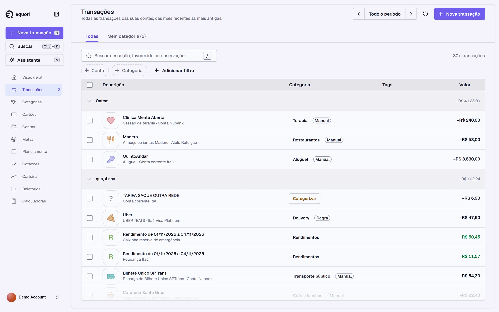
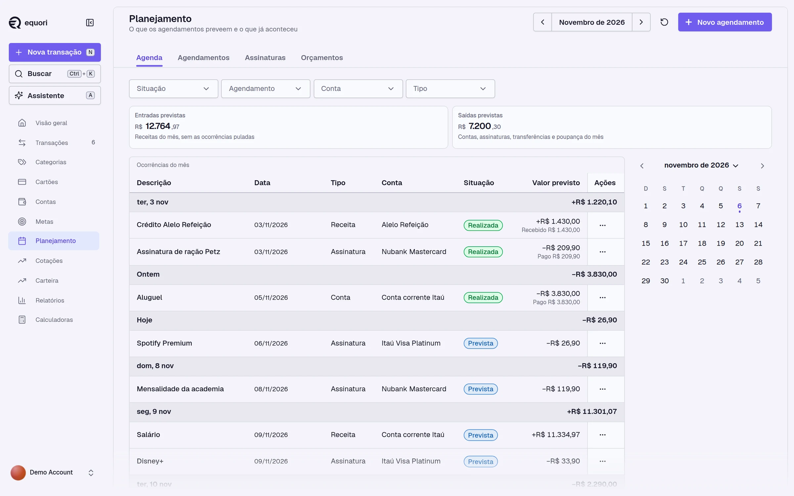
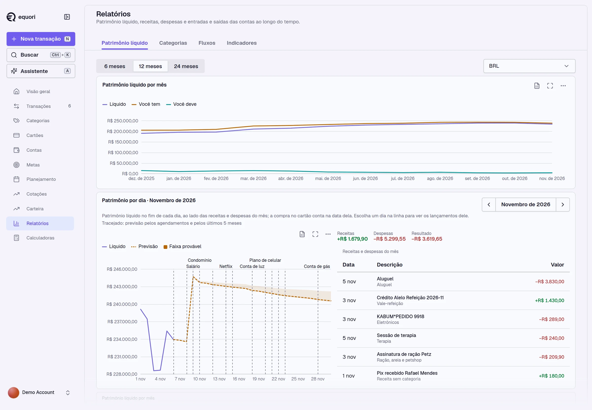
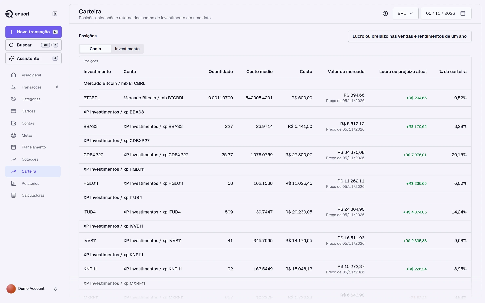

# equori

[](https://github.com/andrelopes-code/equori/actions/workflows/ci.yml)
[](LICENSE)

Self-hosted personal finance manager. One Go binary on PostgreSQL, with the web interface embedded. The data stays on the machine that runs it.

<picture>
  <source media="(prefers-color-scheme: dark)" srcset="docs/assets/transactions-dark.webp">
  
</picture>

Status: early development.

## What it does

- **Ledger.** Accounts, transactions with corrections, voids and version history, transfers, payees and tags.
- **Credit cards.** Billing cycles, statements, installment purchases, statement payments, refunds and disputes.
- **Import and reconciliation.** OFX and CSV import with review of external records, balance assertions and statement reconciliation. Bank sync through Pluggy ([docs/operations/pluggy.md](docs/operations/pluggy.md)).
- **Classification.** Categorization rules with an explicit order, payee aliases and rule suggestions.
- **Planning.** Schedules, subscriptions, budgets, goals and a balance projection built from the schedules.
- **Investments.** Instruments, prices, trades, income and positions with cost, market value and profit or loss.
- **Reports.** Net worth by month and by day, categories, flows and indicators.
- **Assistant.** A chat over the same tools as the HTTP API. External clients reach those tools through MCP ([docs/operations/mcp.md](docs/operations/mcp.md)).

## Screens

The screens below show the demo account in Brazilian Portuguese ([Demo account](#demo-account)).

### Planning

The month schedule lists realized and expected occurrences, with the totals of expected income and expenses.

<picture>
  <source media="(prefers-color-scheme: dark)" srcset="docs/assets/planning-dark.webp">
  
</picture>

### Net worth and forecast

Net worth by month and by day. The dashed line projects the balance from the schedules and from the last five months.

<picture>
  <source media="(prefers-color-scheme: dark)" srcset="docs/assets/reports-dark.webp">
  
</picture>

### Portfolio

Positions with quantity, average cost, market value, profit or loss and share of the portfolio.

<picture>
  <source media="(prefers-color-scheme: dark)" srcset="docs/assets/portfolio-dark.webp">
  
</picture>

## Install

Linux and macOS:

```sh
curl -fsSL https://github.com/andrelopes-code/equori/releases/latest/download/install.sh | sh
```

Windows (PowerShell):

```powershell
irm https://github.com/andrelopes-code/equori/releases/latest/download/install.ps1 | iex
```

The command installs equori under Docker Compose in `~/equori` (`%USERPROFILE%\equori` on Windows) and opens the first access; run again, it upgrades. Guides: [Linux](docs/install/linux.md), [macOS](docs/install/macos.md), [Windows](docs/install/windows.md); in Portuguese: [Linux](docs/install/linux.pt-BR.md), [macOS](docs/install/macos.pt-BR.md), [Windows](docs/install/windows.pt-BR.md).

Phone access over HTTPS: [docs/operations/remote-access.md](docs/operations/remote-access.md).

Archives: each release attaches `equori_<version>_<os>_<arch>.tar.gz` for Linux and macOS and `SHA256SUMS`. The binary needs `EQUORI_DATABASE_URL` pointing to PostgreSQL 18 or later. Verify an archive with:

```sh
gh attestation verify equori_<version>_linux_amd64.tar.gz --repo andrelopes-code/equori
```

### One container

The standalone image holds the application and PostgreSQL; the data lives in the `/data` volume:

```sh
docker run -d --name equori -p 8080:8080 -v equori:/data ghcr.io/andrelopes-code/equori:<version>-standalone
docker logs equori 2>&1 | grep 'first user setup'
```

The line holds the URL of the screen that creates the first user (`/setup#token=...`); `docker exec equori cat /data/setup.url` prints it too.

The app listens on `http://localhost:8080`. `GET /healthz` returns `200` when the database is reachable.

### Operation

Create the first user: while no user exists, every start logs a line `first user setup` whose URL opens the screen that creates it, an admin, with a one-time token (`docker compose logs app | grep 'first user setup'`). The command line does the same (the password is prompted without echo):

```sh
docker compose exec app /equori user create --email you@example.com --language <code> --region <country> --admin
```

Every variable, its default and an example: [docs/install/configuration.md](docs/install/configuration.md).

Data lives in the `pgdata` Docker volume. Back it up with:

```sh
docker compose exec db pg_dump -U equori equori > equori.sql
```

Commands: `serve` (the default), `user create`, `backup`, `restore`, `secrets key`, `secrets rotate`, `reporting rebuild`, `portfolio rebuild`, `planning backfill`, `service install|stop|uninstall` (Windows), `healthcheck`, `version`.

Backup and restore: [docs/operations/backup.md](docs/operations/backup.md). Export, import and archive compatibility between versions: [docs/operations/export.md](docs/operations/export.md). Bank sync through Pluggy and Meu Pluggy: [docs/operations/pluggy.md](docs/operations/pluggy.md).

The Postgres major version is pinned to 18. To upgrade the major version, dump the database, recreate the volume with the new image and restore the dump.

## Documentation

| Topic | Location |
|---|---|
| API contract | [api/openapi.yaml](api/openapi.yaml) |
| HTTP API groups and conventions | [docs/operations/api.md](docs/operations/api.md) |
| Architecture decisions | [docs/adr/](docs/adr/) |
| Domain: vision, language, scenarios, roadmap | [docs/domain/](docs/domain/) |
| Operations: backup, export, remote access, integrations | [docs/operations/](docs/operations/) |
| Contributing | [CONTRIBUTING.md](CONTRIBUTING.md), [CODE_OF_CONDUCT.md](CODE_OF_CONDUCT.md) |
| Changes | [CHANGELOG.md](CHANGELOG.md) |
| Security reports | [SECURITY.md](SECURITY.md) |

## Outside the supported set of 1.0

### Windows

The supported form on Windows is the command of [docs/install/windows.md](docs/install/windows.md). A release attaches `equori_<version>_windows_amd64_setup.exe` only when the release job signed it (ADR 023, W-R6); a release without it has no Windows installer. The installer runs on Windows 10 (1803 or later) and Windows 11, on x64 and on Arm through emulation. The installer holds PostgreSQL 18 and installs the service `equori`, which starts with Windows and listens on `http://127.0.0.1:8080`. It asks for administrator rights once.

When it finishes, the browser opens on the screen that creates the first user. To use equori in a window of its own, open it in Edge or Chrome and choose "Install this site as an app". The Start menu entry `equori` opens it later.

- Data, backups, `secret.key`, `equori.env` and the log (`log\equori.log`) live in `%ProgramData%\equori`.
- Another port: set `EQUORI_HTTP_ADDR=127.0.0.1:<port>` in `%ProgramData%\equori\equori.env`, then restart the service (`Restart-Service equori` in an administrator terminal).
- Before `equori restore`, stop the service: `equori service stop` in an administrator terminal.
- Uninstalling from Settings > Apps asks whether to delete `%ProgramData%\equori`; the answer No keeps it for a later installation.

### Homebrew (macOS, Linux)

```sh
brew install andrelopes-code/equori/equori
brew services start equori
```

Then open the setup URL that the first start writes to `setup.url` in the data directory (`~/Library/Application Support/equori` on macOS, `~/.local/share/equori` on Linux) and to the log.

## Development

Requirements: Go 1.27, Node.js 24 with Corepack enabled (`corepack enable`), Docker, make.

```sh
make hooks    # git hooks of lefthook.yml
make run-dev  # PostgreSQL, the app on :8080 (API reference at /docs) and the Vite dev server
make check    # everything CI runs
```

`CONTRIBUTING.md` lists every command and the conventions of the code.

`dev.env` holds the development environment that `make dev` uses. Loaded into a shell, it lets any subcommand run against the local database:

```sh
set -a; . ./dev.env; set +a
go run ./cmd/equori user create --email you@example.com --admin
```

### Demo account

`make demo` (with `make dev` running) creates the user `demo@equori.local` and fills it with 24 months of data of a Brazilian persona: accounts and cards of four institutions, about 2300 transactions, installment plans, a brokerage portfolio with prices and income, schedules, budgets, goals, rules, imported statements and reconciliation differences. The password is `$EQUORI_DEMO_PASSWORD`, `equori-demo-account` by default. `make demo-reset` deletes the user and every row it owns. The persona and the plan are in `docs/plans/2026-10-24-demo-account.md`.

The instruments and prices of the demo are shared by every user of the instance.

## License

MIT
