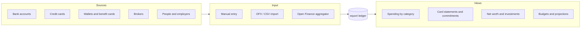

# 1. Vision

Status: approved

## 1.1 Problem

A person's financial data is spread across bank accounts, credit cards, digital wallets and brokers. Each institution shows its own slice, in its own format, with its own categories.

The usual tools have known failure modes:

| Tool | Failure mode |
|---|---|
| Spreadsheet | Manual entry, formula drift, balances that stop matching the bank, no installment or statement logic |
| Bank app | One institution only; categories cannot be changed or extended |
| Commercial aggregator app | Data held by a third party, closed model, fixed categorization, subscription lock-in |

## 1.2 Product statement

equori is a self-hosted, open-source personal finance manager that keeps a complete and verifiable record of a person's money: where it comes from, where it goes, what is already committed for the future and what the person owns.

## 1.3 Users

| User | Description |
|---|---|
| Owner | One person running their own instance. The only user of the first version (ADR 003). |
| Self-hoster | Anyone deploying the open-source image; may live outside Brazil. The region and language of the profile select the base currency, the calendar, the tax jurisdiction and the text conventions (ADR 016, `docs/contributing/regions.md`). |
| Household member | Later: additional users with isolated data on the same instance (ADR 003, "Deferred"). |

## 1.4 Goals

| ID | Goal | Description |
|---|---|---|
| G1 | Spending visibility | Income and expenses by category and period, in two views: cash basis (when money left the account) and accrual basis (when the expense happened). |
| G2 | Cards and commitments | Open and future credit card statements, installments still to be billed, and the share of future income already committed. |
| G3 | Net worth and investments | Net worth over time; positions per asset with cost and market value; returns. |
| G4 | Planning | Budgets per category and period, projected balance per account, savings goals. |
| G5 | Effortless recording | Recording a transaction requires the minimum input; import and integrations are the primary path, manual entry the fallback. |
| G6 | Integrations | File import (OFX, CSV) and Open Finance aggregators behind the `aggregator` registry in `internal/ingestion/ingestion.go` (`pluggy` is the only entry, through Meu Pluggy). |
| G7 | Categorization | Every expense and income is categorized. The category tree is user-defined. User-defined rules categorize automatically; manual corrections can become rules. |
| G8 | Trust | Balances always reconcile with institution statements; imports never duplicate; every change is traceable. |
| G9 | Complete coverage | Every account type and transaction kind in section 1.5 is representable without special cases outside the model. Card statements, installments, refunds, reimbursements and transfers are first-class. |
| G10 | Correct time handling | Recurrences, subscriptions, statement closing and due dates, installment schedules, cancellations and anticipations follow the rules of section 1.6, including business days and rule changes over time. |
| G11 | Analytics foundation | The stored data supports any later report, visualization or aggregation without schema changes: stable identifiers, dated facts, full history, balance series and a documented export (section 1.7). |

## 1.5 Coverage

The model must represent every item below. Each item gets at least one worked example in chapter 6 (Scenarios).

### 1.5.1 Account types

| ID | Account type | Examples |
|---|---|---|
| A01 | Checking account | Nubank, Itaú, Banco do Brasil |
| A02 | Savings account | Poupança |
| A03 | Cash | Physical wallet |
| A04 | Digital wallet / payment account | Mercado Pago, PicPay, PayPal |
| A05 | Credit card | One account per card product; additional cards share the statement |
| A06 | Benefit card | Meal and food vouchers (VR, VA, Alelo, Flash), restricted to a spending purpose |
| A07 | Brokerage / investment account | XP, BTG, Rico; holds cash and assets |
| A08 | Foreign currency account | Wise, Nomad, Inter Global |
| A09 | Loan or financing | Personal loan, vehicle or real estate financing |
| A10 | Receivable / payable | Money lent to or owed by a person; reimbursement owed by an employer |
| A11 | Yield-bearing reserve | Sub-balance inside an institution that earns daily yield: Nubank "caixinhas", PicPay "cofrinhos", Inter "porquinhos", CDB with daily liquidity |

### 1.5.2 Transaction kinds

| ID | Transaction kind | Notes |
|---|---|---|
| M01 | Income | Salary, freelance payment, gift |
| M02 | Expense | Paid by PIX, debit card, boleto, cash, direct debit, benefit card |
| M03 | Transfer between own accounts | PIX/TED between own accounts, cash withdrawal, cash deposit |
| M04 | Credit card purchase | Single payment |
| M05 | Installment purchase | Interest-free ("parcelado sem juros") and with interest; each installment billed on a later statement |
| M06 | Card refund | Full or partial, of a single or installment purchase; may land on a later statement |
| M07 | Card fees and charges | Annual fee, IOF, late fee, revolving interest, statement installment interest |
| M08 | Statement payment | Full, partial or minimum; from any account; early payment |
| M09 | Statement installment plan | Unpaid statement balance converted into installments ("parcelamento de fatura") |
| M10 | Cashback and rewards | Credit on statement or account |
| M11 | Foreign currency purchase | Original amount, exchange rate, IOF |
| M12 | Currency exchange | Conversion between own accounts in different currencies |
| M13 | Reimbursement | Expense paid now, reimbursed later by an employer or another person, fully or partially |
| M14 | Shared expense | One payment split among several people; each share becomes a receivable |
| M15 | Loan given or taken | Principal, interest, repayments |
| M16 | Financing installment | Principal and interest separated |
| M17 | Investment purchase and sale | Quantity, unit price, fees, taxes |
| M18 | Investment income | Dividends, JCP, interest, coupon, maturity |
| M19 | Opening balance | Initial state of an account when tracking starts |
| M20 | Balance adjustment | Difference found at reconciliation, recorded explicitly |
| M21 | Scheduled and recurring transactions | Planned transactions that become real when they happen |
| M22 | Chargeback / dispute | Contested card charge, pending until resolved |
| M23 | Yield on balance | Daily yield credited by the institution on checking balances and reserves (section 1.7, B04) |
| M24 | Tax withheld on redemption | Income tax (regressive table) and IOF (first 30 days) withheld when yield is redeemed |
| M25 | Installment cancellation | Purchase cancelled after some installments were billed; remaining installments cancelled, billed ones refunded |
| M26 | Installment anticipation | Future installments paid early, with or without discount |
| M27 | Subscription | Recurring charge with price changes over time, pauses and cancellation |
| M28 | Payroll breakdown | Gross salary, deductions (INSS, IRRF, benefits) and net amount credited |
| M29 | Attachment | Receipt, invoice or contract attached to any transaction |

## 1.6 Time and calendar requirements

| ID | Requirement |
|---|---|
| T01 | Recurrence rules cover: every N days, weeks, months or years; a fixed day of the month; the last day of the month; the Nth weekday of the month; the Nth business day of the month. Each rule has a start date and an optional end date or occurrence count. |
| T02 | A day of month that does not exist in a month (31 in April, 29–31 in February) resolves to the last day of that month. |
| T03 | Each occurrence of a recurrence has an expected amount, which may vary, and is linked to the real transaction once it happens. Occurrences can be skipped or moved one by one without changing the rule. |
| T04 | A credit card has a closing day and a due day. A purchase before the closing date belongs to the statement that closes on that date; a purchase after it belongs to the next one. A purchase on the closing date belongs to the next statement by default; each card can set it to the closing statement, because issuers differ. |
| T05 | Closing and due days change over time. A change applies from a given statement on; past statements keep their dates. |
| T06 | A due date on a non-business day moves according to a business-day calendar. Each card and each schedule names a calendar; the default comes from the owner's region (`DefaultCalendar` in `internal/marketdata/region_defaults.go`): `br_banking` for `BR`, `weekend` otherwise. |
| T07 | Installment N of a purchase is billed on the Nth statement from the purchase statement, not on a calendar month offset. |
| T08 | Cancellation and anticipation change the remaining schedule of an installment purchase without rewriting billed installments. |
| T09 | Rules that change over time (subscription price, card closing day, recurring amount) are effective-dated: each version has a start date, and history is kept. |
| T10 | Calendar dates follow ADR 005: accounting dates are calendar days in the instance time zone; instants are UTC. |

## 1.7 Balance, calculation and data requirements

| ID | Requirement |
|---|---|
| B01 | A balance is never stored as editable state. It is derived from the postings of the account. |
| B02 | The balance of any account is available at any past date, and as a daily series, for any date range. |
| B03 | The balance reported by the institution is stored as a separate dated fact (balance assertion), from import, integration or manual entry. The difference to the derived balance is always visible. |
| B04 | Yield on balances (M23) does not require one manual transaction per day. It enters the ledger from the integration feed when available; otherwise one yield transaction per reconciliation closes the gap between the derived and the asserted balance, categorized as yield income. |
| B05 | Totals across currencies use the exchange rates stored in the ledger; the rate used is always traceable. |
| B06 | Amounts and arithmetic are exact: integer minor units, no floating point (ADR 005). |
| B07 | Every fact has a stable identifier, the date it refers to and the instant it was recorded. Corrections keep history: a changed fact remains traceable to its previous version. |
| B08 | Aggregations (by category, period, account, institution, tag, currency) are computed from facts; precomputed aggregates, when added for performance, are derived data that can be rebuilt at any time. |

## 1.8 Success criteria

| ID | Criterion | Verification |
|---|---|---|
| SC1 | For every account, the balance computed at a statement date equals the institution's statement balance. | Reconciliation report: difference = 0 |
| SC2 | Importing the same file or sync window twice creates zero new transactions. | Import test with repeated input |
| SC3 | Every transaction is balanced: its postings sum to zero. | Database constraint and domain test |
| SC4 | Recording a manual expense requires at most 3 inputs: amount, account, category. Date defaults to today. | UI and API contract |
| SC5 | The share of transactions categorized by rules, by import data and manually is measured and displayed. | Report |
| SC6 | All data can be exported at any time in an open, documented format. | Export endpoint and format spec |

## 1.9 Constraints

- Self-hosted: one binary plus PostgreSQL, distributed in the forms of ADR 022. License MIT.
- Brazilian context first: BRL, credit card statements with closing and due dates, interest-free installments ("parcelado sem juros"), PIX, boleto, Open Finance Brasil.
- Multi-currency in the core model from the first schema version, even while the interface shows BRL only.
- Conventions of ADR 005: integer minor units, calendar dates in the instance time zone, cursor pagination.

## 1.10 Non-goals

| Non-goal | Reason |
|---|---|
| Moving money (payment initiation, PIX transfers, trading orders) | equori records money; it does not move it. |
| Business accounting (company books, NF-e issuance) | Personal finance only. |
| Hosted multi-tenant service | Self-hosted product. |
| Native mobile apps | Responsive web interface first. |

## 1.11 Decisions

| ID | Decision |
|---|---|
| D1 | The model stores every datum required for income tax, and derives the tax class and the tax treatment of income from the owner's jurisdiction (`Jurisdiction` in `internal/portfolio/internal/domain/jurisdiction.go`; `br` is the only implementation). The data required for Brazilian income tax (IRPF) is: trade date, quantity, unit price, fees, taxes withheld, income type (exempt dividends, taxable JCP, taxable yield) and average cost by Receita Federal rules. Generating the annual declaration report is a later feature. Stored from P8 on in `ledger_trade`, `ledger_investment_income` and the `portfolio_` tables (chapter 7, 7.4). |
| D2 | Transactions accept attachments (M29). Files are stored in PostgreSQL, so one database backup contains all data. Limit: 10 MiB per file. |
