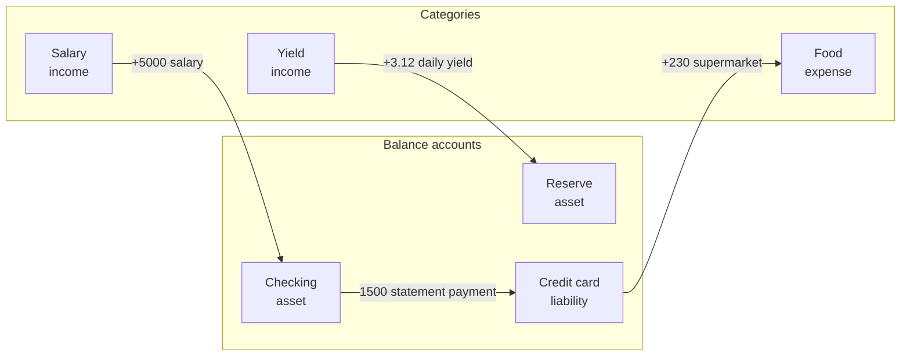
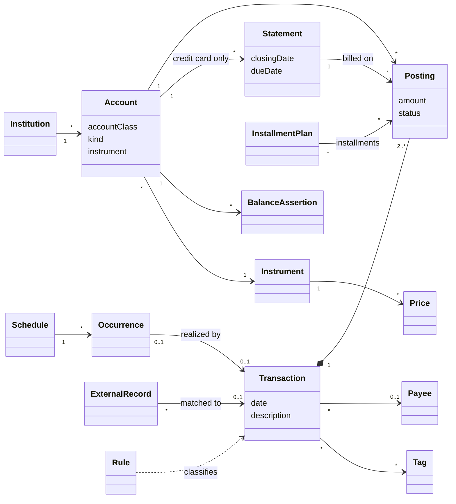

# 2. Ubiquitous language

Status: approved

Every term below has one meaning in this book, in the code, in the database and in the API. The Portuguese column is the fixed translation used in the interface for Brazilian users. A term not listed here is not part of the domain language until it is added to this chapter.

## 2.1 Modeling stance

equori records money with **double-entry bookkeeping**: every transaction is a set of postings that sum to zero. Money never appears or disappears; it moves between accounts. Expense and income categories are accounts too, so a purchase moves value from a card account to an expense account.

Arrows show where value comes from and where it goes. Each arrow is one transaction with two postings of opposite sign.

## 2.2 Concept map

## 2.3 Core ledger

| Term | Portuguese | Definition | Example |
|---|---|---|---|
| Ledger | Livro-razão | The complete, ordered set of transactions of one user. | All records of the owner since tracking started |
| Transaction | Transação | An event that changes balances, dated on the day it happened, made of two or more postings that sum to zero per instrument. A transaction is the unit of creation, correction and deletion. | "Supermarket, 2026-10-14": card −230.00, Food +230.00 |
| Posting | Partida | One line of a transaction: an account and a signed amount in the account's instrument. | Food +230.00 BRL |
| Sign convention | Convenção de sinal | Positive amounts increase asset and expense accounts; negative amounts increase liability, income and equity accounts. The interface shows natural signs per account class. | A purchase is +230 on Food and −230 on the card; the card screen shows "230.00 owed" |
| Balance | Saldo | Sum of the postings of an account up to and including a date. Always derived, never stored as editable state (B01). | Checking balance on 2026-10-31 |
| Transaction date | Data da transação | The calendar day the event happened (accrual basis). | Purchase day |
| Posting status | Situação da partida | `pending`: authorized or scheduled, not yet settled. `cleared`: settled by the institution. `reconciled`: confirmed against an institution statement or balance assertion; changes require an explicit unlock of the account from a date (P3 amendment A8). | A card authorization is `pending` until it appears on the statement |
| Link | Vínculo | A typed relation between two transactions. Types: `refund_of`, `reimbursement_of`, `cancellation_of`, `anticipation_of`, `chargeback_of`, `correction_of`. | A refund transaction `refund_of` the original purchase |
| Opening balance | Saldo inicial | Transaction that sets the balance of an account on the first tracked day, against the equity account "Opening balances". | Checking holds 1,240.55 on 2026-01-01 |
| Balance adjustment | Ajuste de saldo | Transaction that closes an unexplained difference found at reconciliation, against the equity account "Adjustments". | −2.10 found missing after checking the bank statement |
| Correction | Correção | A change to a recorded transaction. The previous version stays in history (B07). | Amount changed from 23.00 to 32.00 |

## 2.4 Accounts and institutions

| Term | Portuguese | Definition | Example |
|---|---|---|---|
| Account | Conta | Anything that holds a balance: a real-world account, a credit card, a reserve, a receivable, or a category. Every account has one instrument. | "Nubank checking", "Food" |
| Account class | Natureza da conta | The accounting nature of an account: `asset`, `liability`, `equity`, `income`, `expense`. Determines the sign convention. | Credit card: `liability` |
| Account kind | Tipo de conta | The real-world form of an asset or liability account (A01–A11): `checking`, `savings`, `cash`, `wallet`, `credit_card`, `benefit`, `brokerage`, `reserve`, `loan`, `receivable`, `payable`. | Nubank "caixinha": `reserve` |
| Balance account | Conta patrimonial | An account of class `asset` or `liability`. Its balance is money the user has or owes. | Checking, credit card, loan |
| Category | Categoria | An account of class `income` or `expense`, organized in a tree. The interface calls it a category. | Expense › Food › Supermarket |
| Equity account | Conta de patrimônio líquido | An account of class `equity` used only for opening balances and adjustments. | "Opening balances" |
| Institution | Instituição | Organization that holds or issues balance accounts. | Nubank, XP, Alelo |
| Parent account | Conta pai | A balance account that groups sub-accounts at the same institution. The parent balance is the sum of its children. | Nubank checking with three reserves |
| Reserve | Reserva | A sub-account of kind `reserve` inside an institution, earning yield (A11). | "Emergency fund" caixinha |
| Receivable | Valor a receber | Asset account for money owed to the user by a person or organization. | Ana owes 100.00 from a shared dinner |
| Payable | Valor a pagar | Liability account for money the user owes to a person or organization. | 50.00 owed to a friend |
| Counterparty | Contraparte | The person or organization behind a receivable or payable. | Ana, Employer Ltda |

## 2.5 Credit cards

| Term | Portuguese | Definition | Example |
|---|---|---|---|
| Card account | Conta do cartão | Liability account of kind `credit_card`. Its balance is the total debt, including installments not yet billed. | "Itaú Visa" balance −3,450.00 |
| Card | Cartão | A physical or virtual card of a card account, with holder and last four digits. Additional and virtual cards share the card account and its statements. | Virtual card •••• 4021 |
| Credit limit | Limite | Maximum debt of a card account, effective-dated. Available limit = limit − debt. | 10,000.00 from 2026-03-01 |
| Billing cycle rule | Regra de ciclo | The closing day, the due day and the closing-day assignment of a card account, effective-dated (T05). Closing-day assignment: whether a purchase made on the closing date goes to the `next` statement (default) or to the `closing` statement (T04). | Closes on day 3, due on day 10, closing-day purchases to the next statement, from statement 2026-11 |
| Statement | Fatura | The bill of one billing cycle of a card account, identified by its reference month, with closing date, due date and the postings billed on it. | Statement 2026-11: closes 2026-11-03, due 2026-11-10 |
| Card posting role | Papel da partida no cartão | Classification of every card posting: `charge` (purchase, installment, fee, interest), `credit` (refund, cashback, reversal), `payment` (statement payment or financing settlement). | Statement payment posting: `payment` |
| Billed on | Faturado em | The statement a card posting belongs to. Defaults from the transaction date and the billing cycle rule (T04); import data can set it explicitly. | Purchase on 2026-11-04 billed on statement 2026-12 |
| Statement status | Situação da fatura | `open` (accepting postings), `closed` (closing date passed, unpaid), `paid`, `partially_paid`, `overdue`. Derived from dates and payments. | |
| Statement payment | Pagamento de fatura | Transaction from a balance account to a card account whose card posting has role `payment` and is billed on the statement it pays. Full, partial, minimum or early. | Checking −1,500.00, card +1,500.00 |
| Installment purchase | Compra parcelada | A transaction whose card postings are split into N installments billed on N consecutive statements. The expense is recorded in full on the transaction date. | 1,200.00 in 12× 100.00 |
| Installment | Parcela | One of the card postings of an installment purchase, with number and total ("3/12"). | Installment 3/12 billed on statement 2027-01 |
| Installment plan | Plano de parcelamento | The schedule that groups the installments of one purchase or of a financed statement balance, with interest when present. | 12× without interest; 10× with 1.99% monthly interest |
| Statement financing | Parcelamento de fatura | Installment plan created from an unpaid statement balance (M09). | Remaining 2,000.00 in 6× |
| Revolving credit | Crédito rotativo | Unpaid statement balance carried to the next statement with interest. | 500.00 unpaid; interest charged on statement 2026-12 |
| Card charge | Encargo | Fee, tax or interest posted by the issuer on a statement (M07). | Annual fee, IOF, late fee |
| Refund | Estorno | Transaction that returns all or part of a card purchase, linked `refund_of` the purchase (M06). | 50.00 returned on statement 2026-12 |
| Chargeback | Contestação | Disputed charge, linked `chargeback_of` the purchase, with pending outcome (M22). | |
| Cashback | Cashback | Credit from the issuer posted to the card or to another account, as income. | 1% back on statement |

## 2.6 Time and recurrence

| Term | Portuguese | Definition | Example |
|---|---|---|---|
| Accounting date | Data contábil | A calendar day in the instance time zone (ADR 005). | 2026-10-14 |
| Instant | Instante | A point in time in UTC. | 2026-10-14T17:03:22Z |
| Business-day calendar | Calendário de dias úteis | The set of non-business days used to shift due dates (T06). | Brazilian national holidays |
| Effective-dated value | Valor com vigência | A value with a validity start date; earlier versions are kept (T09). | Subscription price 39.90 from 2026-01-01, 44.90 from 2026-07-01 |
| Schedule | Agendamento | A template transaction plus a recurrence rule that produces occurrences. | "Rent, every month on day 5" |
| Recurrence rule | Regra de recorrência | The rule that generates the dates of a schedule (T01, T02). | Last business day of each month |
| Occurrence | Ocorrência | One expected instance of a schedule, with expected date and expected amount. States: `expected`, `realized` (linked to a transaction), `skipped`, `overdue`. | Rent of 2026-11-05, expected 2,100.00 |
| Subscription | Assinatura | A schedule of kind `subscription`, with effective-dated price, pause and cancellation (M27). | Streaming service, monthly on the card |
| Projection | Projeção | The future balance of an account computed from its balance, open statements, pending installments and expected occurrences. | Checking on 2026-12-31: 4,320.00 projected |

## 2.7 Import and reconciliation

| Term | Portuguese | Definition | Example |
|---|---|---|---|
| Source | Fonte | Where external data comes from: `manual`, `ofx`, `csv`, `open_finance`. | Pluggy connection |
| Import batch | Lote de importação | One run of a file import or an integration sync. | OFX file of October |
| External record | Registro externo | One raw entry received from a source, stored unchanged, with the source's own identifier. | One line of an OFX file |
| Deduplication key | Chave de deduplicação | Identifier that makes re-importing the same external record a no-op (SC2). | Source id + account + external id |
| Matching | Correspondência | Linking an external record to an existing transaction instead of creating a new one. | Imported PIX matched to a manual entry |
| Balance assertion | Saldo informado | The balance an institution reports for an account at a date, stored as a fact (B03). | Bank app shows 3,201.17 on 2026-10-31 |
| Reconciliation | Conciliação | The act of confirming that derived balances equal balance assertions and that every institution entry has a matching posting; confirmed postings become `reconciled`. | October checking reconciled |
| Difference | Diferença | Asserted balance minus derived balance at the assertion date. | +3.12 unexplained, usually yield |

## 2.8 Classification

| Term | Portuguese | Definition | Example |
|---|---|---|---|
| Payee | Favorecido | The merchant, person or organization on the other side of a transaction. Several raw names map to one payee. | "IFD*IFOOD" and "iFood" → iFood |
| Tag | Marcador | Free label orthogonal to categories, for cross-cutting analysis. | "trip-lisbon-2026" |
| Categorization rule | Regra de categorização | Conditions on a transaction or external record (payee, description, amount, account, source) and actions (set category, payee, tags, split). Rules run in priority order. | Description contains "UBER" → Transport › Ride-hailing |
| Split | Divisão | A transaction with more than one expense or income posting. | Supermarket: Food 180.00, Cleaning 50.00 |
| Reimbursement | Reembolso | Money expected back for an expense paid by the user, tracked through a receivable (M13). | Work trip paid on the card, refunded by the employer |
| Shared expense | Despesa compartilhada | One payment split among people; other people's shares become receivables (M14). | Dinner 300.00: own share 100.00, Ana 100.00, Bruno 100.00 |

## 2.9 Instruments and investments

| Term | Portuguese | Definition | Example |
|---|---|---|---|
| Instrument | Instrumento | The unit an amount is denominated in: a currency or a security. | BRL, USD, PETR4, Tesouro IPCA+ 2035 |
| Currency | Moeda | Instrument of type currency, ISO 4217. | BRL |
| Security | Ativo | Instrument of type security: stock, REIT (FII), ETF, bond, fund share, crypto asset. | MXRF11 |
| Price | Cotação | The value of one unit of an instrument in another instrument at a date. Covers exchange rates and asset prices. | 1 USD = 5.4830 BRL on 2026-10-14 |
| Position | Posição | Quantity of a security held in a brokerage account at a date, derived from postings. | 150 MXRF11 |
| Cost basis | Custo de aquisição | Total paid for a position, including fees. | 1,512.40 BRL for 150 MXRF11 |
| Average cost | Preço médio | Cost basis divided by quantity, computed by Receita Federal rules (D1). | 10.0827 BRL |
| Market value | Valor de mercado | Position quantity × latest price. | |
| Investment income | Provento | Dividend, JCP, interest, coupon or yield, with its tax treatment (D1). | JCP 45.00 gross, 6.75 withheld |

## 2.10 Planning and views

| Term | Portuguese | Definition | Example |
|---|---|---|---|
| Budget | Orçamento | Planned amount for a category over a period. | Food: 1,800.00 per month |
| Goal | Meta | Target balance for an account or group of accounts by a date. | Emergency fund 30,000.00 by 2027-06 |
| Accrual view | Visão por competência | Income and expenses on their transaction date. An installment purchase counts in full on the purchase date. | |
| Cash view | Visão por caixa | Income and expenses on the date money left or entered a balance account. A card expense counts when its statement is paid, in proportion to the payment. | |
| Committed amount | Valor comprometido | Sum of installments not yet billed and expected occurrences in a future period. | 2,340.00 already committed for 2026-12 |
| Net worth | Patrimônio líquido | Sum of all balance accounts (assets − liabilities) at a date, converted with stored prices (B05). | |
