# 3. Domain flows

Status: approved

This chapter lists what happens in the domain, in order, as an Event Storming board. It describes domain facts and rules only; how they are stored is decided in chapter 7.

## 3.1 Notation

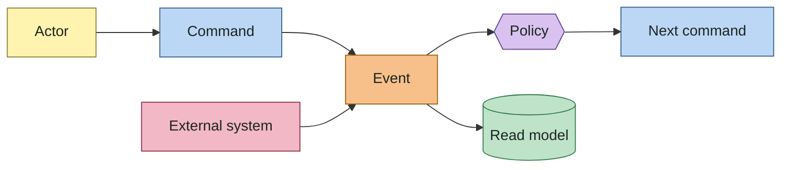

| Element | Meaning | Naming |
|---|---|---|
| Actor | Who triggers a command: the owner, an import, the clock | Noun |
| Command | An intention, which may be rejected by an invariant | Imperative: `RecordTransaction` |
| Event | A fact that happened and is never undone, only compensated | Past tense: `TransactionRecorded` |
| Policy | An automatic reaction: "whenever event X, do command Y" | "When … then …" |
| Read model | Information derived from events for a view | Noun: "Statement view" |
| External system | Bank file, aggregator, price feed | Name |

## 3.2 Flow overview

| ID | Flow | Covers (chapter 1) |
|---|---|---|
| F1 | Transaction lifecycle | M01–M04, M28, M29, B07 |
| F2 | Card purchase and statement | M04–M10, M22, T04, T05, T07, T08 |
| F3 | Installment changes | M05, M06, M25, M26 |
| F4 | Import and sync | G5, G6, SC2 |
| F5 | Categorization | G7, SC5 |
| F6 | Reconciliation and yield | M19, M20, M23, M24, B03, B04, SC1 |
| F7 | Schedules and subscriptions | M21, M27, T01–T03, T09 |
| F8 | Reimbursements, shared expenses and loans | M13–M16 |
| F9 | Currencies and investments | M11, M12, M17, M18, B05, D1 |

## 3.3 F1 Transaction lifecycle

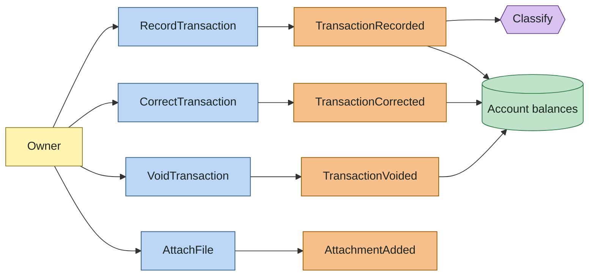

| Event | Data | Rules |
|---|---|---|
| `TransactionRecorded` | id, transaction date, description, payee, postings, tags, source | Postings sum to zero per instrument. At least two postings. Every posting account belongs to the user and is open on the transaction date. |
| `TransactionCorrected` | id, new version, previous version, reason | A `reconciled` posting cannot change without an explicit unlock. The previous version stays readable (B07). |
| `TransactionVoided` | id, reason | The transaction stops affecting balances and stays in history. Linked transactions are reported, not voided in cascade. |
| `AttachmentAdded` | transaction id, file metadata, content hash | Maximum 10 MiB (D2). The same content attached twice is stored once. |

## 3.4 F2 Card purchase and statement

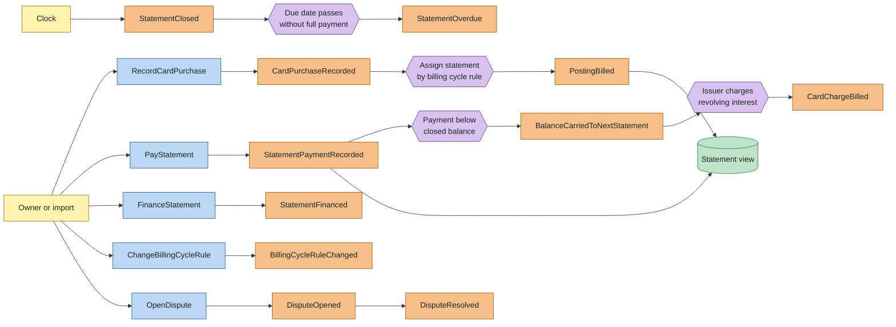

| Event | Data | Rules |
|---|---|---|
| `CardPurchaseRecorded` | transaction, card, installment count, interest | A `TransactionRecorded` whose card postings carry statement assignments. With N installments, the card side has N postings and the expense side has the full amount. |
| `PostingBilled` | posting, statement | Default statement: the first statement whose closing date is after the transaction date, or equal to it when the card's closing-day assignment is `closing`, under the billing cycle rule effective for that statement (T04, T05). Installment k goes to the (k−1)-th statement after the first (T07). An explicit statement from import data overrides the default. |
| `StatementClosed` | statement, closed balance | Happens on the closing date. Postings may still be added to it (history back-fill, late issuer charges); its postings become immutable when reconciled. |
| `StatementPaymentRecorded` | transaction, statement, amount | Transfer from a balance account to the card account; the card posting has role `payment` and is billed on the paid statement. Allowed before closing (early payment), after closing, and after the due date. |
| `StatementOverdue` | statement, unpaid amount | Due date (shifted by the business-day calendar, T06) passed with paid amount < closed balance. |
| `BalanceCarriedToNextStatement` | from, to, amount | The unpaid part of a closed statement appears as the opening amount of the next one. No new transaction: the card account balance already holds the debt. |
| `CardChargeBilled` | transaction, statement, charge type | Interest, IOF, late fee, annual fee, posted by the issuer as an expense on a statement. |
| `StatementFinanced` | statement, installment plan | The unpaid amount becomes N installments on the next statements, with interest as a separate expense. The financed statement is settled by the plan. |
| `BillingCycleRuleChanged` | card account, closing day, due day, closing-day assignment, effective statement | Applies from the effective statement on. Postings already billed do not move. |
| `DisputeOpened` / `DisputeResolved` | purchase, outcome | Outcome `won` creates a refund linked `chargeback_of`; outcome `lost` closes the dispute without a transaction. |

### 3.4.1 Statement lifecycle

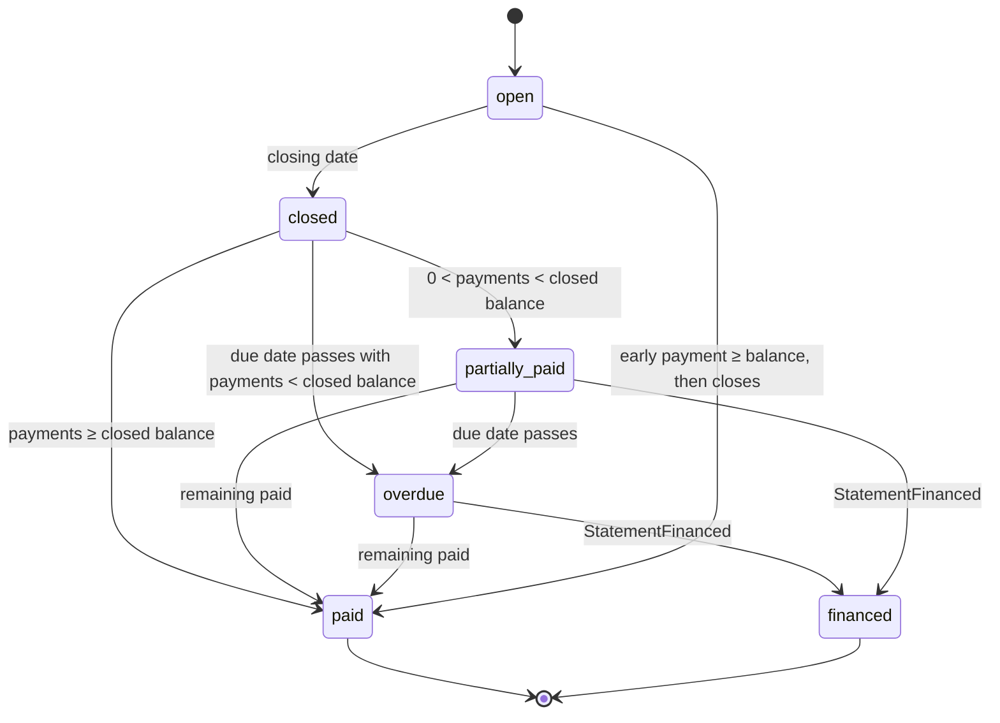

## 3.5 F3 Installment changes

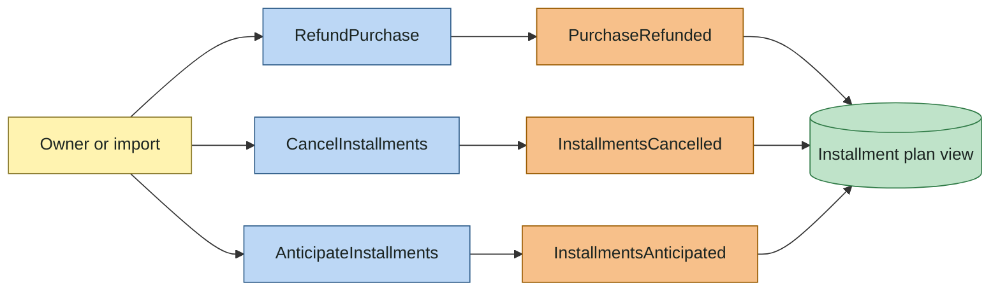

| Event | Data | Rules |
|---|---|---|
| `PurchaseRefunded` | refund transaction, original, amount, statement | Linked `refund_of`. Card side positive on the statement where the issuer credits it; expense side negative in the original category. Partial refunds allowed; the sum of refunds never exceeds the original amount. |
| `InstallmentsCancelled` | plan, cancelled installment numbers, refunded billed amount | A new transaction linked `cancellation_of` reverses the unbilled installments (positive card postings on their original statements, negative expense). Billed installments are refunded according to the issuer: on one statement or spread. Billed postings are never edited (T08). |
| `InstallmentsAnticipated` | plan, installment numbers, target statement, discount | A new transaction linked `anticipation_of` moves the selected future installments to the target statement: it reverses them on their original statements and posts their discounted total on the target. The discount is income in category "Discounts". |

## 3.6 F4 Import and sync

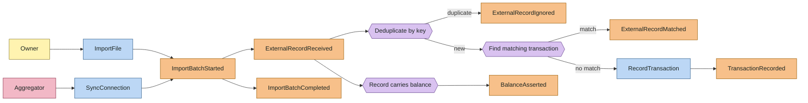

| Event | Data | Rules |
|---|---|---|
| `ImportBatchStarted` / `ImportBatchCompleted` | batch, source, account, period, counts | One batch per file or sync run. Counts: received, ignored, matched, created. |
| `ExternalRecordReceived` | batch, raw payload, external id, deduplication key | The raw payload is stored unchanged, once per deduplication key (I10). A record an interrupted import left `received` is processed again by the next import that carries it (P4 amendment A12). |
| `ExternalRecordIgnored` | record, existing record | Same deduplication key already received and processed (SC2); counted on the batch, not stored. |
| `ExternalRecordMatched` | record, transaction | An existing transaction on the same account, with the same amount, within a date window (default ±3 days) and not yet matched. The posting status becomes `cleared`. Ingestion chooses among the account's postings that no record confirms (5.7, Matcher); a record confirms one posting, on its own account, so one transfer carries the record of each side (P5b amendment A27); a candidate taken by an earlier line of the same file is excluded (I07). Ambiguous candidates go to review, where the owner matches, creates or discards (`ResolveMatch`). |
| `TransactionRecorded` (from import) | as in F1, source = import | The account posting comes from the record; the other side is the system account `uncategorized_expense` for a negative amount and `uncategorized_income` for a positive one, and goes through F5. On a card account a negative amount is a `charge` and a positive one a `credit`, billed by T04 (P4 amendment A14). The transaction carries the external record id, so a repeated call returns it instead of a duplicate (A11). Pending card authorizations are recorded as `pending`. |
| `BalanceAsserted` | account, date, amount, source | Created when the source reports a balance (OFX ledger balance, aggregator balance). Starts F6. A balance the ledger rejects (a future date, a date before the last reconciliation) is reported on the batch as skipped with the reason; the import still completes. An aggregator balance holds at the date of the item's last update, is asserted again only when it changes, and never records yield (P6 amendment A42). |
| `SyncConnection` | connection | Aggregator syncs (P6 amendments A34–A43): one batch with source `open_finance` per mapped external account; the window starts at the mapping's start date, then 30 days before the last synced date, and ends today; the deduplication key is the aggregator's line id. A scheduler syncs connections whose item has new data; an item that needs its owner (`LOGIN_ERROR`, `OUTDATED`, `WAITING_USER_INPUT`) is not synced. Each check stores when the provider will next update the item, which the connection reports; a Meu Pluggy item refuses an update requested through the API, so the owner waits for that time (A95). A line the ledger refuses waits for review. |
| `ExternalRecordUpdated` | record, status, bill | A stored aggregator line whose status, bill or amount changed (A36): a posted line clears its posting; a card line with a bill moves to the statement due on the bill's due date, else to that date's month (A39). A line matched under a new id moves its posting to its bill the same way. A reconciled posting and an amount change stay out of the ledger and are described on the record. |
| `ExternalRecordWithdrawn` | record | An aggregator line missing from a later window that covers its date (A38): its posting is released and its transaction stays, so the line returned with a new id confirms it again. |
| `InstallmentLineReceived` | record, installment k of n | A card line of an installment purchase (A40): the first line seen creates the ledger installment purchase from the statement k − 1 months before the line's; the others confirm their installments. A line of another amount, or of a reversed purchase, waits for review. |

## 3.7 F5 Categorization

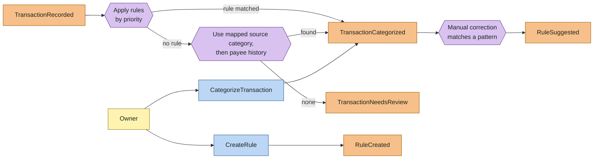

| Event | Data | Rules |
|---|---|---|
| `TransactionCategorized` | transaction, category postings, method | Method: `rule`, `source`, `history`, `manual` (SC5). Automatic categorization acts only on transactions whose category postings are all uncategorized, so a manual categorization is never overwritten by a rule (P5 amendment A17). Imported lines are decided before the Ledger records them (A19); other transactions are decided after `TransactionRecorded`. The Ledger publishes it as `ledger.transaction_categorized.v1` with the cause of the decision, and Classification records the method of each transaction from the Ledger events, by transaction version (A20). |
| `TransactionNeedsReview` | transaction, reason | Reasons: no category, ambiguous match, possible duplicate, unknown payee. |
| `RuleSuggested` | conditions, actions, example transactions | Proposed when two transactions with the same match key (the payee, or the normalized raw description without a payee) are corrected manually to the same single category; one suggestion per match key and category ever exists (P5 amendment A24). |
| `TransactionTransferred` | transaction, account, paired transaction | `Transfer` replaces the category side with a posting on another asset or liability account; a card credit becomes a payment. When the other side was imported uncategorized within ±3 days, the two pair: one keeps both postings and both records, the other is voided (`ledger.transactions_paired.v1`). An imported line decided as a transfer completes that other side instead of creating a transaction (P5b amendments A28–A30). |
| `RuleCreated` / `RuleChanged` | rule, priority | Rules can run on existing uncategorized transactions on request. |

## 3.8 F6 Reconciliation and yield

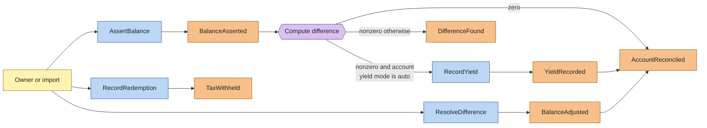

| Event | Data | Rules |
|---|---|---|
| `BalanceAsserted` | account, date, amount, source | Stored as a fact (B03). Several assertions per account and date are allowed; the latest recorded wins for that date. Leaf balance accounts only (P3 amendment A9). |
| `YieldRecorded` | transaction, account, period | Account yield mode `auto` (default for kinds `reserve` and accounts marked as remunerated): a positive difference becomes one transaction: account +difference, income "Yield". Dated on the assertion date; the period starts the day after the previous assertion, or at the account's first posting when there is none (P3 amendment A10). An account with no posting up to the date keeps the difference open. A negative difference never becomes yield. |
| `DifferenceFound` | account, date, difference | Shown until resolved by recording the missing transactions or by `BalanceAdjusted`. |
| `BalanceAdjusted` | transaction, difference | Transaction against the equity account "Adjustments" (M20). |
| `AccountReconciled` | account, date | Postings of the account up to the date become `reconciled`. For a card, the owner confirms a closed statement's amount due instead, and the statement's postings become `reconciled` (P3 amendment A7). |
| `AccountUnlocked` | account, from | Reconciliations dated on or after `from` are deleted and their postings return to `cleared` (P3 amendment A8). |
| `TaxWithheld` | transaction, tax type, base | On redemption from a reserve or fixed income: income tax by the regressive table and IOF before 30 days, as expense postings of type tax (M24, D1). |

## 3.9 F7 Schedules and subscriptions

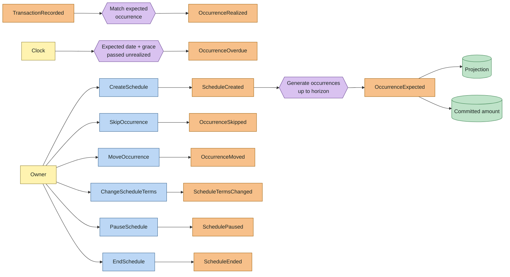

| Event | Data | Rules |
|---|---|---|
| `ScheduleCreated` | template transaction, recurrence rule, start, end or count, kind | Kinds: `bill`, `income`, `subscription`, `transfer`, `savings`. The template is one balance account and one counterpart: an expense category for `bill` and `subscription`, an income category for `income`, another balance account for `transfer` and `savings`; money leaves the balance account for every kind except `income` (P7 amendment A46). In P7 both accounts are in the base currency (A47). |
| `OccurrenceExpected` | schedule, expected date, expected amount | Generated up to a horizon of today + 12 months, which a scheduler moves every hour (A53); generation is idempotent by sequence (A49). Dates follow T01, T02 and T06. |
| `OccurrenceRealized` | occurrence, transaction | A non-voided transaction with a posting on the template account of the kind's sign, a posting on the counterpart, the template payee when it has one, an amount within tolerance (default ±10%, configurable per schedule) and a date within ± 7 days of an expected occurrence realizes the closest one, then the earlier, then the lower sequence. Re-evaluated on every recorded, corrected, categorized and voided transaction; an automatic realization that stops matching is released. The owner may realize and release by hand; ledger changes never release a manual realization, except a void, and a transaction the owner released no longer realizes that occurrence (A51). An occurrence is realized by at most one transaction. |
| `OccurrenceOverdue` | occurrence | Grace period after the expected date (default 3 days). Derived on read, not stored and not published in P7 (A50). |
| `OccurrenceSkipped` / `OccurrenceMoved` | occurrence, reason or new date | Affects only an expected occurrence (T03). A moved occurrence keeps its sequence and its generated date as `moved_from` (A52). A new date inside a pause is refused (422 on `date`), and on or after the end of the schedule returns 409 `schedule_ended`. |
| `ScheduleTermsChanged` | schedule, new amount or rule, effective date | Effective-dated (T09) after the latest version: occurrences before the date keep their terms; expected occurrences after it that were not moved are regenerated where occurrences existed, continuing the sequence, or after the highest sequence a kept occurrence holds for another date (A49, A52). Realized, skipped and moved occurrences never change. Without a rule the previous rule is kept, start included. |
| `SchedulePaused` / `ScheduleEnded` | schedule, from date | No occurrences are generated in the paused interval `[from, to]` or on and after the end; their expected occurrences are removed, realized ones stay. Pauses never overlap (A52). |

## 3.10 F8 Reimbursements, shared expenses and loans

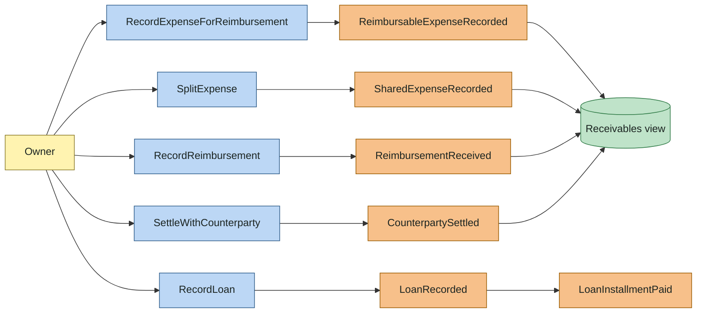

| Event | Data | Rules |
|---|---|---|
| `ReimbursableExpenseRecorded` | transaction, counterparty, expected amount | The reimbursable part posts to the counterparty's receivable, not to an expense. A non-reimbursable part posts to an expense category. |
| `ReimbursementReceived` | transaction, receivable, amount | Linked `reimbursement_of`. Partial amounts allowed. A remainder that will not be paid is written off to an expense category by the owner. |
| `SharedExpenseRecorded` | transaction, shares | Own share to the expense category; each other share to the counterparty's receivable. Shares sum to the paid amount. |
| `CounterpartySettled` | transaction, counterparty, amount | Payment between the owner and a counterparty, settling receivables and payables in any combination. |
| `LoanRecorded` | loan account, principal, rate, installment plan | Loan taken: liability. Loan given: receivable. |
| `LoanInstallmentPaid` | transaction, installment | Principal reduces the loan account; interest is an expense (taken) or income (given) (M16). |

## 3.11 F9 Currencies and investments

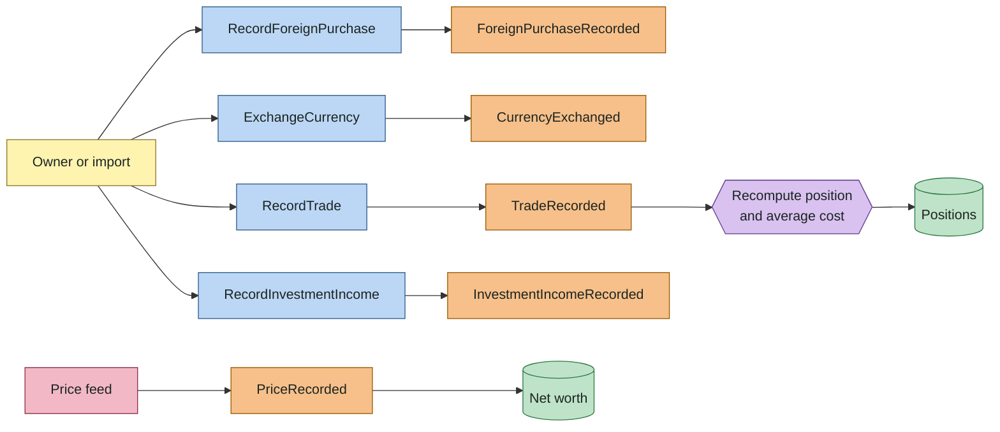

| Event | Data | Rules |
|---|---|---|
| `ForeignPurchaseRecorded` | transaction, original amount, rate, IOF | `POST /foreign-purchases` on an account in the base currency: amount = original × rate, IOF = amount × `iof_rate_bp` ÷ 10000 (default 350) on its own expense posting; the account and category postings keep the original amount, so the rate is amount ÷ original (M11, P8 amendment A66). |
| `CurrencyExchanged` | transaction, rate | `POST /exchanges` between accounts of two currencies, one of them the base currency: the foreign side's weight is the base amount without the fee; the fee is a base-currency expense posting (M12, A67). |
| `TradeRecorded` | transaction, security, quantity, unit price, fees, taxes | `POST /trades`. Buy: cash −(gross + fees); security +quantity with weight gross + fees. Sell: cost = weight sum × quantity ÷ held quantity (half to even; the whole weight sum for a full sale); result = gross − fees − cost to realized gains or losses; taxes withheld to an expense posting. A change dated on or before a recorded sale of the account is refused (D1, A68, A69). |
| `InvestmentIncomeRecorded` | transaction, security, type, gross, withheld | `POST /investment-income`. Types: dividend (exempt), JCP (15% withheld by default), interest, coupon. Gross to the income category, withheld to tax expense (D1, A70). Amortization is not recorded in P8. |
| `PriceRecorded` | instrument, quote instrument, date, value, source | Prices are facts; several sources per day allowed; the chosen one has the lowest priority: `manual` 1, `csv` 2, `bcb_ptax` and `b3_cotahist` 3 (A60). |

These events are `ledger.transaction_recorded.v1` with a `trade` or `investment_income` detail on the transaction; `PriceRecorded` is not published (no consumer reads prices through the outbox).

## 3.12 Invariants found in this chapter

Each invariant is enforced in the domain and covered by a scenario in chapter 6.

| ID | Invariant |
|---|---|
| I01 | The weights of the postings of a transaction sum to zero (refined in chapter 5, 5.2.3). |
| I02 | A transaction has at least two postings. |
| I03 | A posting on a card account belongs to exactly one statement of that account. |
| I04 | A posting on any other account belongs to no statement. |
| I05 | `reconciled` postings are never edited or deleted; changes are new transactions linked to the original. A statement's closing date does not freeze its postings (P2 amendment A3). |
| I06 | The total refunded or cancelled for a purchase never exceeds its original amount. |
| I07 | An occurrence is realized by at most one transaction; an external record confirms at most one posting, and a transaction holds at most one record per account (P5b amendment A27). |
| I08 | Effective-dated values never overlap: at any date exactly one version is in force. |
| I09 | A posting's account is open on the transaction date. |
| I10 | A deduplication key appears at most once per user. |
