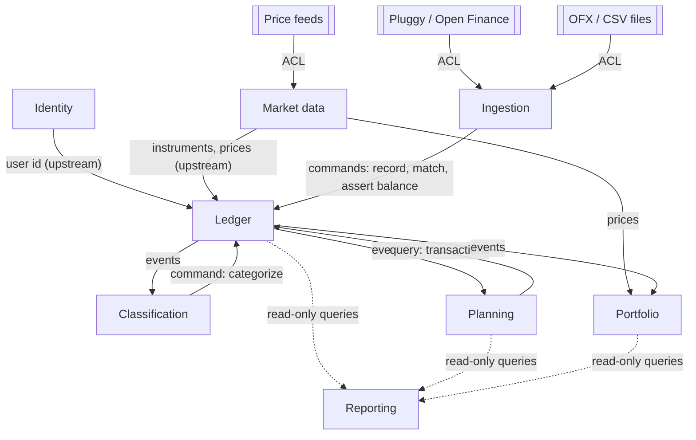
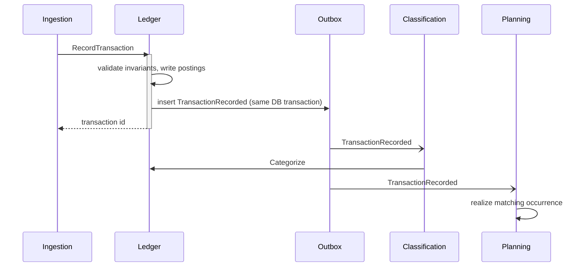

# 4. Bounded contexts

Status: approved

A bounded context is a part of the domain with its own model and its own data, implemented as one module of the modular monolith (ADR 002). A transaction of the database never spans contexts; contexts cooperate through module APIs and domain events.

## 4.1 Subdomains

| Subdomain | Type | Context | Reason for the type |
|---|---|---|---|
| Bookkeeping, cards, statements, installments | Core | Ledger | Correctness of every balance depends on it (G8, G9). |
| Schedules, subscriptions, budgets, goals, projections | Core | Planning | Commitments and projections are the main differentiator (G2, G4). |
| Categorization rules and payees | Core | Classification | Categorization quality decides the value of every report (G7). |
| File import and aggregator sync | Supporting | Ingestion | Translates external formats; no rules of its own beyond deduplication and matching. |
| Positions, average cost, tax data | Supporting | Portfolio | Derived from ledger postings by Receita Federal rules (D1). |
| Instruments and prices | Supporting | Market data | Reference data used by Ledger and Portfolio. |
| Reports and analytics | Supporting | Reporting | Read-only views over the other contexts (G11). |
| Users and sessions | Generic | Identity | Implemented (ADR 003). |

## 4.2 Context map

| Relationship | Pattern | Meaning |
|---|---|---|
| Ledger → all downstream contexts | Open host service + published language | Ledger exposes a stable module API and a documented set of domain events. Downstream contexts never read Ledger tables, except Reporting. |
| Pluggy, OFX, CSV → Ingestion | Anti-corruption layer | External formats are translated into Ingestion's own model before reaching Ledger. A change in Pluggy's API changes one adapter. |
| Price feeds → Market data | Anti-corruption layer | Same, for prices. |
| Ingestion → Ledger | Customer / supplier | Ingestion uses Ledger commands; Ledger keeps its invariants. |
| Classification → Ledger | Customer / supplier | Classification decides categories; Ledger records them. |
| Planning, Portfolio → Ledger | Conformist | They adopt Ledger's events and identifiers as they are. |
| Reporting → Ledger, Planning, Portfolio | Read-only shared database | Reporting reads tables of other contexts with `SELECT` only (ADR 002). |
| Identity → all | Upstream | Every context stores `user_id` and receives it from the request (ADR 003). |

## 4.3 Contexts

### 4.3.1 Ledger

| Item | Content |
|---|---|
| Responsibility | Accounts of every class, transactions, postings, links, card statements, billing cycle rules, installment plans, balance assertions, reconciliation, payees, tags, attachments. |
| Invariants | I01–I06, I08–I09 (chapter 3). |
| Commands | `RecordTransaction`, `CorrectTransaction`, `VoidTransaction`, `RecordCardPurchase`, `PayStatement`, `FinanceStatement`, `RefundPurchase`, `CancelInstallments`, `AnticipateInstallments`, `ChangeBillingCycleRule`, `AssertBalance`, `Reconcile`, `RecordYield`, `AdjustBalance`, `Categorize`, `AttachFile`, account and payee management. |
| Queries | Balance at a date, balance series, statements, postings by account and period, transaction by id, installment plans. |
| Events published | `TransactionRecorded`, `TransactionCorrected`, `TransactionCategorized`, `TransactionVoided`, `StatementClosed`, `StatementOverdue`, `BalanceAsserted`, `DifferenceFound`, `AccountReconciled`, `AccountOpened`, `AccountClosed`. |

Card statements and installment plans stay in Ledger: recording a card purchase creates postings and their statement assignments in one database transaction (I03), which a context boundary would split.

### 4.3.2 Classification

| Item | Content |
|---|---|
| Responsibility | Categorization rules, rule suggestions, payee aliases (raw name → payee), categorization method statistics (SC5). |
| Reacts to | `TransactionRecorded`, `TransactionCorrected`, `TransactionCategorized`, `TransactionVoided` (categorization records, manual changes feed suggestions). |
| Commands | `CreateRule`, `ChangeRule`, `ReorderRules`, `RunRules`, `AcceptSuggestion`, `DismissSuggestion`, `MapPayeeAlias`, `DecideImport` (called by Ingestion, P5 amendment A19). |
| Events published | `RuleSuggested`. Transactions that need review are the uncategorized ones (`GET /transactions?uncategorized=true`). |
| Calls | Ledger `Categorize` and the Ledger reads it decides from (transaction facts, accounts, payees, payee history). |

### 4.3.3 Ingestion

| Item | Content |
|---|---|
| Responsibility | Sources, aggregator connections and their credentials, import batches, external records, deduplication keys, matching candidates, review queue for ambiguous matches. |
| Invariants | I07 (external record side), I10. |
| Commands | `ImportFile`, `SyncConnection`, `ConnectAggregator`, `ResolveMatch`. |
| Events published | `ImportBatchCompleted`, `ExternalRecordNeedsReview`. |
| Calls | Ledger `RecordTransaction`, `RecordCardPurchase`, `AssertBalance`, match commands; Classification `DecideImport` before recording created lines. |

### 4.3.4 Planning

| Item | Content |
|---|---|
| Responsibility | Schedules, recurrence rules, occurrences, subscriptions, budgets, goals, projections, committed amounts. |
| Invariants | I07 (occurrence side), I08 for schedule terms. |
| Reacts to | `TransactionRecorded`, `TransactionVoided` (realize or release occurrences). |
| Commands | `CreateSchedule`, `ChangeScheduleTerms`, `PauseSchedule`, `EndSchedule`, `SkipOccurrence`, `MoveOccurrence`, `SetBudget`, `SetGoal`. |
| Events published | `OccurrenceOverdue`, `BudgetExceeded`. |
| Calls | Ledger queries (balances, open statements, unbilled installments) for projections. |

### 4.3.5 Portfolio

| Item | Content |
|---|---|
| Responsibility | Positions, lots and average cost by Receita Federal rules, realized gains, investment income by tax type, data for the annual declaration (D1). |
| Reacts to | `TransactionRecorded`, `TransactionCorrected`, `TransactionVoided` on brokerage accounts. |
| Queries | Positions at a date, cost basis, realized gains by month, income by tax type. |
| Calls | Market data prices. |

Trades and investment income are Ledger transactions. Portfolio derives everything else from them, so a correction in Ledger recomputes positions.

### 4.3.6 Market data

| Item | Content |
|---|---|
| Responsibility | Instruments (currencies, securities), prices and exchange rates with source and date, business-day calendars. |
| Commands | `DefineInstrument`, `RecordPrice`, `ImportPrices`, `DefineHoliday`. |
| Queries | Instrument by code, price at a date, business days in a range. |

### 4.3.7 Reporting

| Item | Content |
|---|---|
| Responsibility | Spending by category and period (accrual and cash views), net worth series, statement analytics, commitments, budget progress, export (SC6). |
| Data | Read-only queries over Ledger, Planning and Portfolio tables; derived tables (B08) rebuilt from facts. |

## 4.4 Communication between contexts

| Mechanism | Used for | Guarantee |
|---|---|---|
| Module API call | Commands and queries across contexts | Synchronous, in-process; each call runs its own database transaction in the callee. |
| Domain event | Policies of chapter 3 that cross contexts (classify, realize occurrence, recompute position) | Transactional outbox (ADR 006): the event row is written in the same database transaction as the change; a dispatcher in the same process delivers it after commit. Delivery is at least once; consumers are idempotent by event id. |

Consequence: a view may show a transaction as uncategorized for the time between commit and the Classification reaction (milliseconds in normal operation). A crash between commit and delivery delays the reaction until restart; it never loses it.

## 4.5 Module layout

| Context | Module | Owner of tables with prefix |
|---|---|---|
| Identity | `internal/identity` | `identity_` |
| Ledger | `internal/ledger` | `ledger_` |
| Classification | `internal/classification` | `classification_` |
| Ingestion | `internal/ingestion` | `ingestion_` |
| Planning | `internal/planning` | `planning_` |
| Portfolio | `internal/portfolio` | `portfolio_` |
| Market data | `internal/marketdata` | `marketdata_` |
| Reporting | `internal/reporting` | `reporting_` (derived data only) |
| Outbox (shared infrastructure) | `internal/platform/outbox` | `outbox_` |
