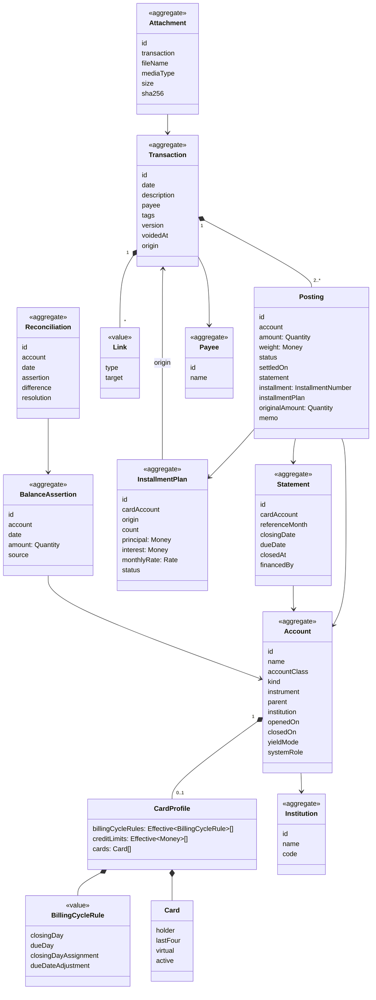
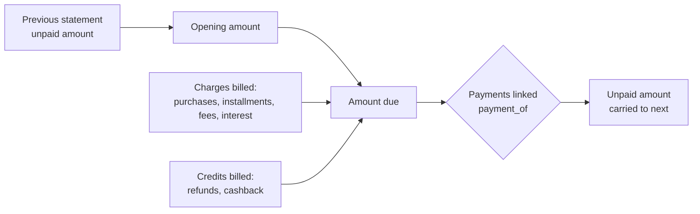
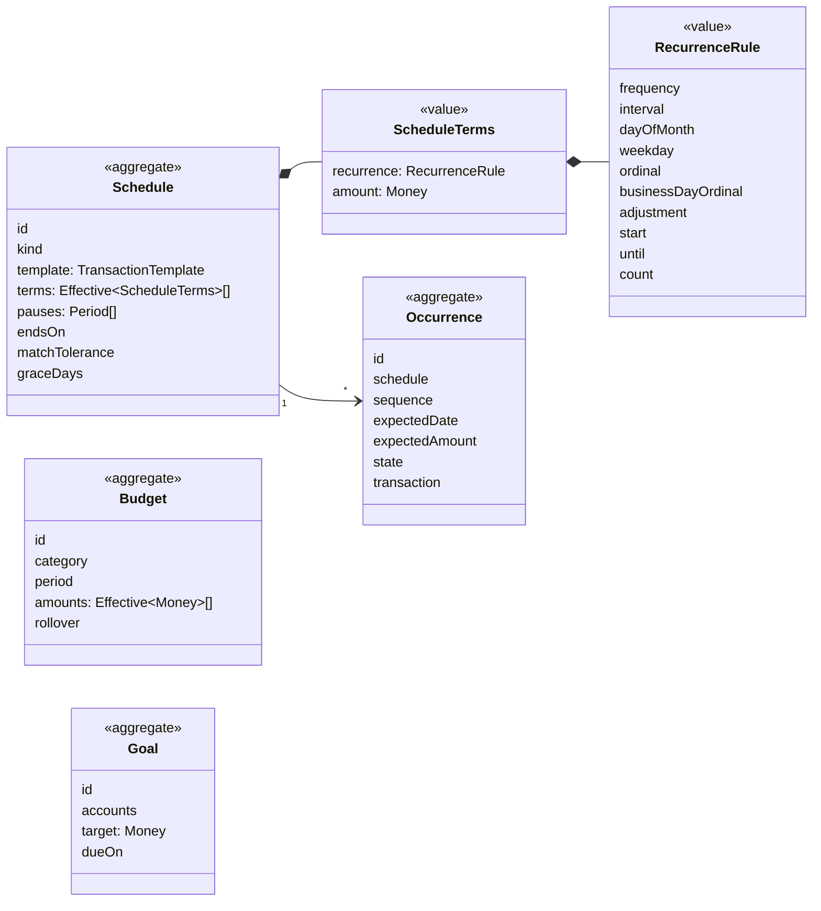
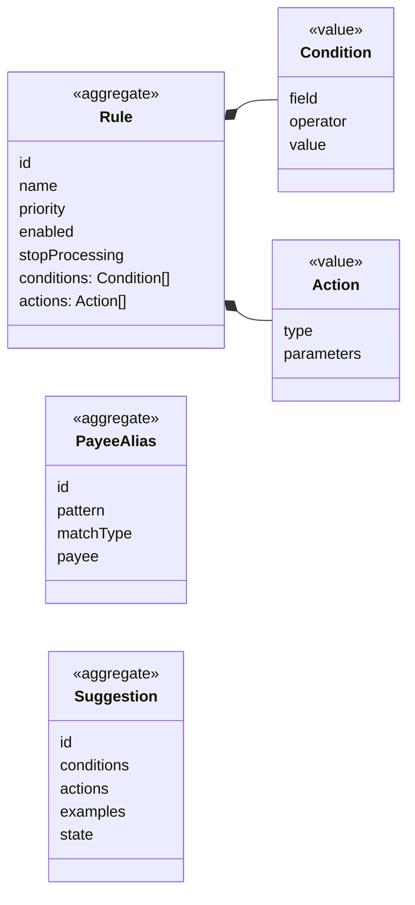
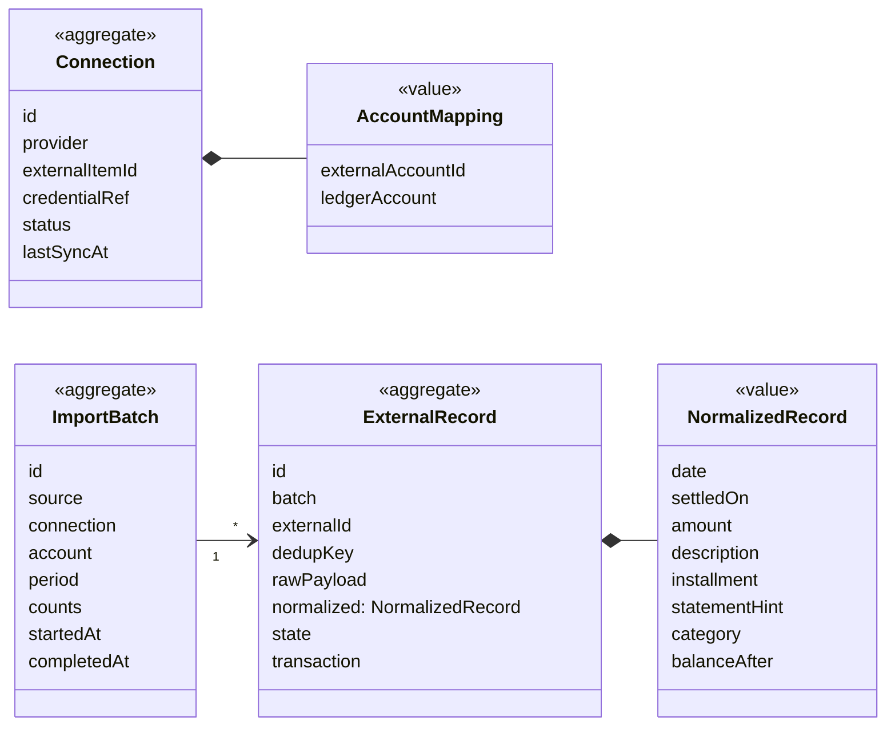

# 5. Domain model

Status: approved

This chapter defines, per context, the aggregates (consistency boundaries), their entities and value objects, and the rules each one enforces. An aggregate is the unit loaded, validated and saved in one database transaction; other aggregates are referenced by identifier only.

## 5.1 Shared value objects

| Value object | Definition | Rules |
|---|---|---|
| `Money` | Amount of a currency in integer minor units (`platform/money`, ADR 005). | \|amount\| ≤ 2^53 − 1. Arithmetic only within one currency. |
| `Quantity` | Amount of any instrument as an integer of units scaled by the instrument's `scale` (number of decimals). | BRL scale 2; JPY 0; MXRF11 scale 0; Bitcoin scale 8; fund shares scale 6. `Money` is the `Quantity` of a currency. |
| `InstrumentCode` | Identifier of an instrument: ISO 4217 for currencies, exchange ticker or registry code for securities. | Unique per instance. |
| `AccountingDate` | Calendar day (ADR 005). | No time component. |
| `Period` | Half-open interval of accounting dates `[from, to)`. | `from < to`. |
| `ReferenceMonth` | Year and month identifying a statement or a budget period. | `2026-11`. |
| `Effective[T]` | A value of type T with a validity start date (T09). | Versions of the same subject never overlap (I08). |
| `Rate` | Exact decimal ratio, stored as an integer mantissa and a scale. | Used for prices and interest rates. Conversion to `Money` rounds half to even, once, at the end. |
| `InstallmentNumber` | Pair `k / N`. | 1 ≤ k ≤ N ≤ 420. |

## 5.2 Ledger

### 5.2.1 Class diagram

### 5.2.2 Account

| Field | Rule |
|---|---|
| `accountClass` | `asset`, `liability`, `equity`, `income`, `expense`. Immutable. |
| `kind` | Required for `asset` and `liability`, absent otherwise. Allowed pairs in the table below. Immutable after the first posting. |
| `instrument` | One per account. Immutable after the first posting. A brokerage account holding several securities is a parent account with one child per instrument (cash child plus one child per security). |
| `parent` | Same user, same class. Balance accounts: same institution. A parent of a balance account has no postings of its own; its balance is the sum of its children. Categories form a tree of any depth. |
| `openedOn`, `closedOn` | Postings only between them (I09). Closing requires a zero balance. |
| `yieldMode` | `none`, `auto` (F6). Default `auto` for kind `reserve`, `none` otherwise. |
| `systemRole` | Marks accounts the domain refers to: `opening_balances`, `adjustments`, `uncategorized_expense`, `uncategorized_income`, `yield`, `discounts`, `interest`, `taxes`, `fees`, `realized_gains`, `realized_losses`. Created with the user; renamable, not deletable. |

| Kind | Class | Notes |
|---|---|---|
| `checking`, `savings`, `cash`, `wallet`, `benefit`, `reserve` | asset | `reserve` is a child of a `checking` or `wallet` parent account. |
| `brokerage` | asset | Parent with one child per instrument held. |
| `receivable` | asset | One per counterparty. |
| `credit_card` | liability | Has a `CardProfile`. |
| `loan` | liability or asset | Liability when taken, asset when given. |
| `payable` | liability | One per counterparty. |

### 5.2.3 Transaction and postings

| Rule | Statement |
|---|---|
| I01 (refined) | Each posting has an `amount` in its account's instrument and a `weight` in the transaction's balancing currency. The weights of a transaction sum to zero. When the account instrument is the balancing currency, `weight = amount`. When it differs, `weight` is the explicit value of the posting in the balancing currency, and `weight / amount` is the rate used (B05). |
| I02 | At least two postings. |
| Balancing currency | The user's base currency (BRL by default), unless every posting shares another currency, in which case that one. |
| Posting status | `pending`, `cleared`, `reconciled` (chapter 2). The transaction has no status of its own. |
| `settledOn` | Date the institution settled the posting, when it differs from the transaction date (debit purchase on Saturday, settled on Monday). Balances can be computed by transaction date (default) or by settlement date (the institution's view, used in reconciliation). |
| `statement` | Required on card account postings, forbidden on others (I03, I04). |
| `installment`, `installmentPlan` | Set together, only on card postings that belong to a plan. |
| `originalAmount` | Amount in the currency of the original charge when it differs from the account instrument (foreign purchase on a BRL card, M11). Informational; the rate is `amount / originalAmount`. |
| Correction | A correction creates version n+1 of the same transaction and keeps version n in history. Allowed while no posting of the transaction is `reconciled` and no card posting belongs to a closed statement (I05). Otherwise the change is a new transaction linked `correction_of`. |
| Void | Sets `voidedAt`; the transaction stops counting in every balance. Same restrictions as correction. |
| Origin | `manual`, `import`, `schedule`, `system` (yield, adjustment, revolving). Informational. |

Example of I01 with two currencies (exchange of 5,483.00 BRL into 1,000.00 USD):

| Account | Amount | Weight (BRL) |
|---|---|---|
| Checking (BRL) | −5,483.00 BRL | −5,483.00 |
| Wise (USD) | +1,000.00 USD | +5,483.00 |
| Sum of weights | | 0.00 |

### 5.2.4 Statement

| Rule | Statement |
|---|---|
| Creation | A statement exists for every reference month from the card's first posting to the last statement with a billed installment. It is created on demand by the billing service. |
| Dates | `closingDate` and `dueDate` come from the billing cycle rule in force for that reference month (T05). The due date is shifted by the business-day calendar per `dueDateAdjustment` (`following` by default) (T06). Stored on creation; later rule changes do not move them unless the statement is still open and has no postings. |
| Amount due | Opening amount + charges − credits. Derived, never stored. |
| Payments | Card postings with a positive amount linked `payment_of` the statement. A payment posting is billed on the statement it pays. |
| Unpaid amount | Amount due − payments, when positive after the due date. Becomes the opening amount of the next statement (revolving credit). |
| Status | Derived from dates, amount due and payments (chapter 3, 3.4.1). |
| Closed | After `closingDate`, adding or changing a posting on the statement requires the issuer origin flag (late issuer charge) and is never allowed for user-entered postings (I05). |

### 5.2.5 Installment plan

| Rule | Statement |
|---|---|
| Split | Principal ÷ N in minor units; the remainder goes to the first installment (1,000.00 in 3× = 333.34 + 333.33 + 333.33). Imported data overrides the split. |
| Interest | For plans with interest, the total interest is recorded at purchase in the `interest` category; installment amounts are (principal + interest) split as above. |
| Statements | Installment k is billed on statement `firstStatement + (k − 1)` (T07). |
| Refund, cancellation, anticipation | Recorded as new transactions linked to the origin (F3). The plan keeps the running totals; refunded + cancelled ≤ principal + interest (I06). |
| Status | `active` (unbilled installments remain), `completed`, `cancelled`, `anticipated`. Derived from its postings. |
| Statement financing | A plan whose origin is a financing transaction instead of a purchase (M09). |

### 5.2.6 Balance assertion and reconciliation

| Rule | Statement |
|---|---|
| Assertion | Amount in the account instrument at the end of a date, by settlement date. Immutable; a new assertion supersedes it. |
| Difference | Assertion amount − balance by settlement date at that date. |
| Resolution | `none` (difference is zero), `yield` (F6 auto), `adjustment`, `transactions_added`. |
| Effect | On resolution, the account's postings with settlement date ≤ assertion date become `reconciled`. |

## 5.3 Planning

| Rule | Statement |
|---|---|
| Recurrence | `frequency` ∈ daily, weekly, monthly, yearly; `interval` ≥ 1. Monthly selectors, exactly one: `dayOfMonth` (1–31, or −1 for last day, T02), `weekday` + `ordinal` (2nd Tuesday, last Friday), `businessDayOrdinal` (5th business day, −1 for last). `adjustment` for non-business days: `none`, `following`, `preceding`, `modified_following`. End: `until` or `count` or neither. |
| Template | Accounts, payee, category postings and description of the transaction to expect; amounts come from the terms. |
| Occurrence identity | `(schedule, sequence)`; sequence numbers never change when terms change, so realized and skipped occurrences stay attached. |
| Terms change | Effective-dated (T09): expected occurrences after the date are regenerated; realized occurrences never change. |
| Budget | Amount per category and period (monthly by default), effective-dated. `rollover`: unspent amount carries to the next period when true. Spending is read from Ledger postings in the category subtree, accrual view by default. |

## 5.4 Classification

| Rule | Statement |
|---|---|
| Condition fields | description, raw description, payee, amount, absolute amount, account, account kind, source, transaction date weekday, day of month, installment present. |
| Operators | equals, contains, starts with, regex (RE2), between, greater than, less than, in list. All conditions of a rule must hold. |
| Actions | set category, set payee, add tags, split by fixed amounts or percentages, mark as transfer to account, mark reimbursable to counterparty. |
| Order | Rules run by ascending priority; the first matching rule with `stopProcessing` ends evaluation. |
| Precedence | Manual categorization > rule > source category > payee history (F5). |

## 5.5 Ingestion

| Rule | Statement |
|---|---|
| Deduplication key | Source external id when the source provides a stable one (Pluggy transaction id, OFX FITID); otherwise a hash of account, date, amount, normalized description and the ordinal of identical records in the same batch. |
| States | `received`, `ignored` (duplicate), `matched`, `created`, `needs_review`, `discarded` (owner decision). |
| Credentials | Stored encrypted; the encryption ADR precedes the first integration (ADR 003, "Not covered"). |

## 5.6 Portfolio and market data

| Aggregate | Fields | Rules |
|---|---|---|
| `Instrument` (Market data) | code, type, scale, name, currency of quotation, exchange, tax class | Tax class drives D1: `stock`, `fii`, `etf`, `bdr`, `fixed_income`, `fund`, `crypto`, `currency`. |
| `Price` (Market data) | instrument, quote instrument, date, value: `Rate`, source | One chosen price per instrument, quote and date by source priority. |
| `Holiday` (Market data) | calendar, date, name | Calendars: `br_national` (default), user-defined. |
| `Position` (Portfolio, derived) | account, instrument, date, quantity, cost basis | Rebuilt from Ledger postings. Average cost = cost basis ÷ quantity; buys add cost including fees; sells reduce cost at average cost (Receita Federal method). |
| `RealizedResult` (Portfolio, derived) | sale transaction, instrument, quantity, cost, proceeds, result, tax class, month | Input for monthly tax rules (exemptions, day trade) in a later feature (D1). |
| `IncomeEvent` (Portfolio, derived) | transaction, instrument, type, gross, withheld | Types and tax treatment per chapter 3, F9. |

## 5.7 Domain services

| Service | Context | Responsibility |
|---|---|---|
| Billing | Ledger | Resolves the statement of a card posting (T04, T05, T07), creates statements on demand, enforces I03–I05. |
| Installment scheduler | Ledger | Builds installment postings for a purchase or financing (5.2.5). |
| Balance calculator | Ledger | Balance at a date, by transaction or settlement date; daily series; parent aggregation; multi-currency totals through stored weights and prices. |
| Reconciler | Ledger | Difference, yield and adjustment resolution (5.2.6). |
| Occurrence generator | Planning | Expands recurrence rules into dates (T01, T02, T06). |
| Matcher | Ingestion, Planning | Finds candidate transactions for an external record or an occurrence. |
| Rule engine | Classification | Evaluates rules (5.4). |
| Business-day calendar | Market data | Shifts dates and counts business days. |

## 5.8 Decisions in this chapter

| ID | Decision | Alternative not taken |
|---|---|---|
| DM1 | Every posting stores its weight in the balancing currency explicitly. | Rate × amount computed on read: introduces rounding differences between reads. |
| DM2 | Interest of an installment purchase is recorded in full at purchase, in the `interest` category. | Interest spread per installment: more postings, same cash view. |
| DM3 | The rounding remainder of an installment split goes to the first installment, unless imported data says otherwise. | Last installment. |
| DM4 | A correction is a new version of the same transaction while nothing in it is reconciled or on a closed statement; afterwards only compensating transactions. | Compensating transactions only: noisy history for typo fixes. |
| DM5 | One instrument per account; brokerage accounts are parents with one child per instrument. | Multi-instrument accounts: balance is no longer a single number. |
| DM6 | Statements are aggregates with stored dates; their amounts are derived from postings. | Statement totals stored: duplicate state that can diverge. |
