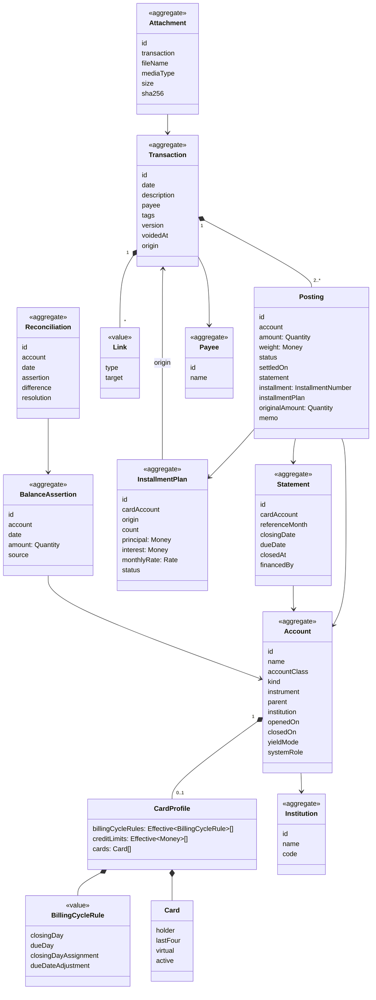
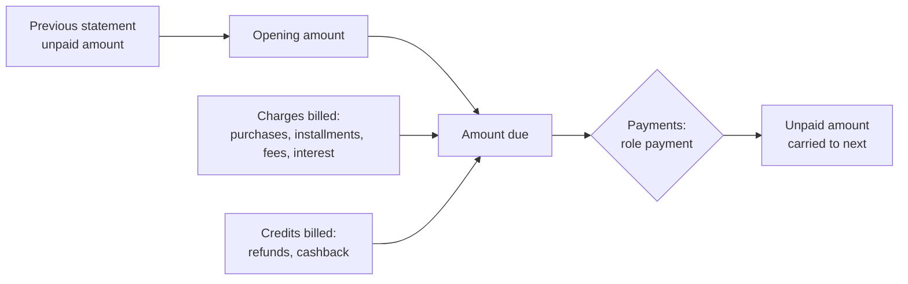
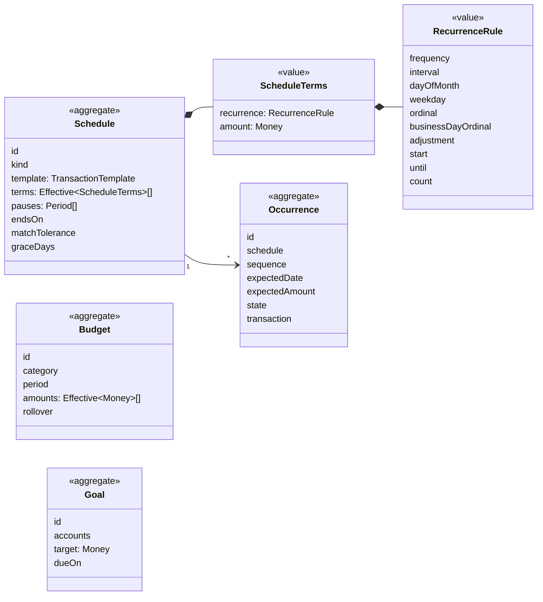
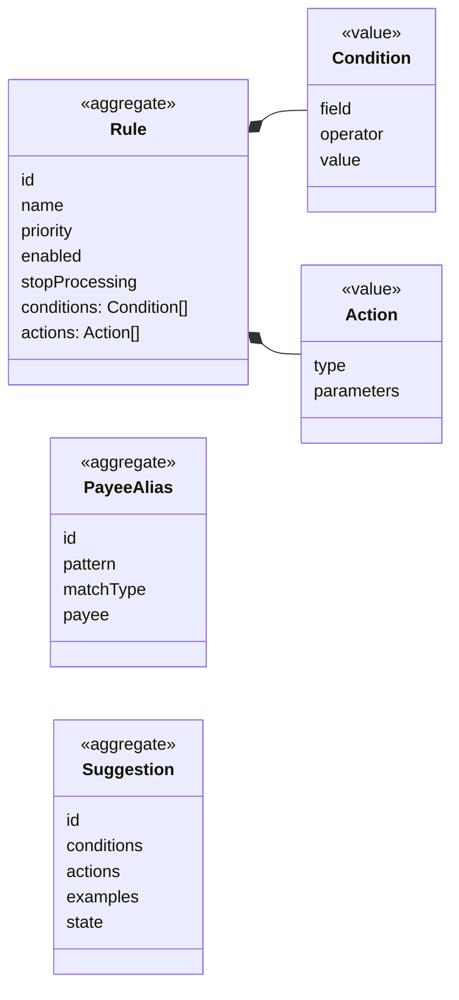
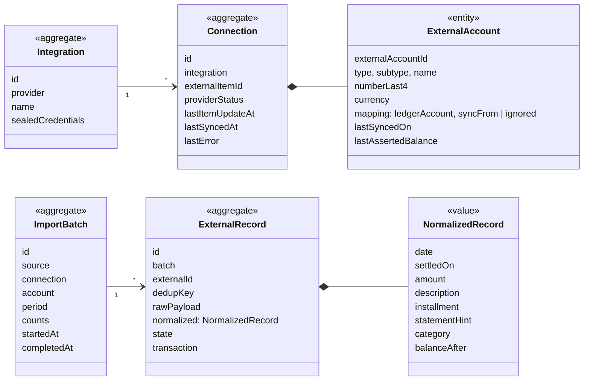

# 5. Domain model

Status: approved

This chapter defines, per context, the aggregates (consistency boundaries), their entities and value objects, and the rules each one enforces. An aggregate is the unit loaded, validated and saved in one database transaction; other aggregates are referenced by identifier only.

## 5.1 Shared value objects

| Value object | Definition | Rules |
|---|---|---|
| `Money` | Amount of a currency in integer minor units (`platform/money`, ADR 005). | \|amount\| ≤ 2^53 − 1. Arithmetic only within one currency. |
| `Quantity` | Amount of any instrument as an integer of units scaled by the instrument's `scale` (number of decimals). | BRL scale 2; JPY 0; MXRF11 scale 0; Bitcoin scale 8; fund shares scale 6. `Money` is the `Quantity` of a currency. In code, `money.Money` carries the instrument code and scale and represents both (P8 amendment A58). |
| `InstrumentCode` | Identifier of an instrument: ISO 4217 for currencies, exchange ticker or registry code for securities. | Unique per instance. |
| `AccountingDate` | Calendar day (ADR 005). | No time component. |
| `Period` | Half-open interval of accounting dates `[from, to)`. | `from < to`. |
| `ReferenceMonth` | Year and month identifying a statement or a budget period. | `2026-11`. |
| `Effective[T]` | A value of type T with a validity start date (T09). | Versions of the same subject never overlap (I08). |
| `Rate` | Exact decimal ratio, stored as an integer mantissa and a scale. | Used for prices and interest rates. Positive, at most 12 decimals. Conversion to `Money` rounds half to even, once, at the end, also across two rates. |
| `InstallmentNumber` | Pair `k / N`. | 1 ≤ k ≤ N ≤ 420. |

## 5.2 Ledger

### 5.2.1 Class diagram

### 5.2.2 Account

| Field | Rule |
|---|---|
| `accountClass` | `asset`, `liability`, `equity`, `income`, `expense`. Immutable. |
| `kind` | Required for `asset` and `liability`, absent otherwise. Allowed pairs in the table below. Immutable after the first posting. |
| `instrument` | One per account. Immutable after the first posting. A brokerage account holding several securities is a parent account with one child per instrument (cash child plus one child per security). A security is held only by a `brokerage` child whose parent is a `brokerage` account in the security's quote currency; a parent whose children hold more than one instrument has a balance only valued in a currency (P8 amendment A63). |
| `parent` | Same user, same class. Balance accounts: same institution. A parent of a balance account has no postings of its own; its balance is the sum of its children. Categories form a tree of any depth. An account is never its own ancestor (A73). |
| `openedOn`, `closedOn` | Postings only between them (I09). Closing requires a zero balance. |
| `yieldMode` | `none`, `auto` (F6). Default `auto` for kind `reserve`, `none` otherwise. |
| `systemRole` | Marks accounts the domain refers to: `opening_balances`, `adjustments`, `uncategorized_expense`, `uncategorized_income`, `yield`, `discounts`, `interest`, `taxes`, `fees`, `realized_gains`, `realized_losses`. Created with the user; renamable, not deletable. |

| Kind | Class | Notes |
|---|---|---|
| `checking`, `savings`, `cash`, `wallet`, `benefit`, `reserve` | asset | `reserve` is a child of a `checking` or `wallet` parent account. |
| `brokerage` | asset | Parent with one child per instrument held. |
| `receivable` | asset | One per counterparty. |
| `credit_card` | liability | Has a `CardProfile`. |
| `loan` | liability or asset | Liability when taken, asset when given. |
| `payable` | liability | One per counterparty. |

### 5.2.3 Transaction and postings

| Rule | Statement |
|---|---|
| I01 (refined) | Each posting has an `amount` in its account's instrument and a `weight` in the transaction's balancing currency. The weights of a transaction sum to zero. When the account instrument is the balancing currency, `weight = amount`. When it differs, `weight` is the explicit value of the posting in the balancing currency, and `weight / amount` is the rate used (B05). |
| I02 | At least two postings. |
| Balancing currency | The user's base currency (BRL by default), unless every posting shares another currency, in which case that one. |
| Posting status | `pending`, `cleared`, `reconciled` (chapter 2). The transaction has no status of its own. |
| `settledOn` | Date the institution settled the posting, when it differs from the transaction date (debit purchase on Saturday, settled on Monday). Balances can be computed by transaction date (default) or by settlement date (the institution's view, used in reconciliation). |
| `statement` | Required on card account postings, forbidden on others (I03, I04). |
| `installment`, `installmentPlan` | Set together, only on card postings that belong to a plan. |
| `originalAmount` | Amount in the currency of the original charge when it differs from the account instrument (foreign purchase on a BRL card, M11). Informational; the rate is `amount / originalAmount`. A currency other than the account instrument, non-zero, with the sign of the amount (P8 amendment A64). |
| Correction | A correction creates version n+1 of the same transaction and keeps version n in history. Allowed while no posting of the transaction is `reconciled` (I05). Otherwise the change is a new transaction linked `correction_of`. |
| Void | Sets `voidedAt`; the transaction stops counting in every balance. Same restrictions as correction. |
| Origin | `manual`, `import`, `schedule`, `system` (yield, adjustment, revolving). Informational. |

Example of I01 with two currencies (exchange of 5,483.00 BRL into 1,000.00 USD):

| Account | Amount | Weight (BRL) |
|---|---|---|
| Checking (BRL) | −5,483.00 BRL | −5,483.00 |
| Wise (USD) | +1,000.00 USD | +5,483.00 |
| Sum of weights | | 0.00 |

### 5.2.4 Statement

| Rule | Statement |
|---|---|
| Creation | A statement exists for every reference month from the card's first posting to the last statement with a billed installment. It is created on demand by the billing service. |
| Dates | `closingDate` and `dueDate` come from the billing cycle rule in force for that reference month (T05). The due date is shifted by the business-day calendar per `dueDateAdjustment` (`following` by default) (T06). Stored on creation. A new rule version re-dates the statements from its effective month whose closing date has not passed; their postings keep the reference month. Closed statements keep their dates. |
| Amount due | Opening amount + charges − credits. Derived, never stored. |
| Payments | Card postings with role `payment`, billed on the statement they pay. Every card posting has a role: `charge`, `credit` or `payment`. |
| Unpaid amount | Amount due − payments, when positive after the due date. Becomes the opening amount of the next statement (revolving credit). |
| Status | Derived from dates, amount due and payments (chapter 3, 3.4.1). |
| Reference month | The month of the due date. The closing date falls in the reference month when `closingDay < dueDay`, otherwise in the previous month (P2 amendment A1). |
| Closed | After `closingDate` the statement is closed; postings may still be added (back-fill, late issuer charges). Its postings become immutable when reconciled (I05, amendment A3). Only the due date is shifted by the calendar (A2). |

### 5.2.5 Installment plan

| Rule | Statement |
|---|---|
| Split | Principal ÷ N in minor units; the remainder goes to the first installment (1,000.00 in 3× = 333.34 + 333.33 + 333.33). Imported data overrides the split. |
| Interest | For plans with interest, the total interest is recorded at purchase in the `interest` category; installment amounts are (principal + interest) split as above. |
| Statements | Installment k is billed on statement `firstStatement + (k − 1)` (T07). |
| Refund, cancellation, anticipation | Recorded as new transactions linked to the origin (F3). The plan keeps the running totals; refunded + cancelled ≤ principal + interest (I06). |
| Status | `active` (unbilled installments remain), `completed`, `cancelled`, `anticipated`. Derived from its postings. |
| Statement financing | A plan whose origin is a financing transaction instead of a purchase (M09). |

### 5.2.6 Balance assertion and reconciliation

| Rule | Statement |
|---|---|
| Assertion | Amount in the account instrument at the end of a date, by settlement date. Immutable; a new assertion supersedes it. |
| Difference | Assertion amount − balance by settlement date at that date. |
| Resolution | `none` (difference is zero), `yield` (F6 auto), `adjustment`, `transactions_added`. |
| Effect | On resolution, the account's postings with settlement date ≤ assertion date become `reconciled`. |
| Scope | Leaf balance accounts. A parent account or a category is rejected (P3 amendment A9). |
| Order | An assertion or resolution dated before the account's last reconciliation is rejected until an unlock. |
| Yield | One transaction on the assertion date: account +difference, income "Yield" (P3 amendment A10). |
| Adjustment | One transaction on the assertion date: account +difference, equity "Adjustments". `transactions_added` requires a zero difference recomputed from the current postings. |
| Statement | A card statement is reconciled when its closing date has passed and the institution's amount due equals the derived amount due; the statement's postings become `reconciled` (P3 amendment A7). |
| Unlock | From a date: the account's reconciliations dated on or after it are deleted; its reconciled postings settled on or after it, and every posting of a deleted statement reconciliation, return to `cleared` (P3 amendment A8). |

## 5.3 Planning

| Rule | Statement |
|---|---|
| Recurrence | `frequency` ∈ daily, weekly, monthly, yearly; `interval` ≥ 1. `daily` counts days from `start`, `weekly` keeps the weekday of `start`, `yearly` the month and day of `start`. Monthly selectors, exactly one: `dayOfMonth` (1–31, or −1 for last day, T02), `weekday` + `ordinal` (2nd Tuesday, last Friday), `businessDayOrdinal` (1–23, −1 for last). A missing Nth weekday or Nth business day resolves to the last one of the month. `adjustment` for non-business days, after the selector and never for `businessDayOrdinal`: `none` (default), `following`, `preceding`, `modified_following`; business days follow calendar `br_banking`. End: `until` (inclusive) or `count` or neither; both apply to the unadjusted dates (P7 amendment A48). |
| Template | One balance account, one counterpart (a category, or a balance account for `transfer` and `savings`), an optional payee and a description; amounts come from the terms (A46). |
| Occurrence identity | `(schedule, sequence)`; sequences count the dates of the schedule from 1 and never change when terms change, so realized, skipped and moved occurrences stay attached (A49). |
| Terms change | Effective-dated (T09) after the latest version: each version produces the dates of its rule up to the next version's date and continues the sequence; expected occurrences after the date that were not moved are regenerated; realized occurrences never change (A49, A52). |
| Budget | One per category, monthly, effective-dated amounts. Spent = postings in the category subtree booked in the month (accrual view), positive for income categories; available = planned + carried − spent; carried = the previous month's available when `rollover` is true, possibly negative (A54). |
| Goal | Current = sum of the booked balances of its balance accounts today; remaining = max(target − current, 0); progress in basis points, rounded down, within [0, 10000] (A55). |

## 5.4 Classification

| Rule | Statement |
|---|---|
| Condition fields | description, raw description (the description of version 1), payee, amount (the negated sum of the category postings: an expense is negative), absolute amount, account (a balance-sheet account of the transaction), account kind, source (transaction origin), transaction date weekday, day of month, installment present. |
| Operators | equals, contains, starts with, regex (RE2), between, greater than, less than, in list, per field as in the table below. All conditions of a rule must hold. |
| Text | Text operators compare normalized text: Unicode lowercase, Latin letters U+00C0–U+017F without diacritics, inner whitespace collapsed, trimmed (`São João` equals `SAO JOAO`). `regex` applies to the original text (P5 amendment A26). |
| Actions | set category, set payee, add tags, split by percentages (basis points, rounded toward zero), fixed amounts and one remainder part. transfer to an asset or liability account, mark reimbursable to a receivable account (S18). A rule has at most one of set category, split, transfer and mark reimbursable (P5b amendment A31). |
| Order | Rules run by ascending priority. The first matching rule that sets a category or split decides the category, the first that sets a payee decides the payee, tags accumulate; a matching rule with `stopProcessing` ends evaluation. A rule whose action cannot apply (category closed on the date, another currency, fixed parts above the total) is skipped (P5 amendment A21). |
| Payee aliases | Applied to the raw description of a transaction without payee, before rules. Order: equals, starts with, contains, regex; within a type the longer pattern first, then the older alias (A22). |
| Payee history | Without a rule category and with a payee, the category of the most recent non-voided transaction of that payee whose only category posting is categorized and of the same class (A23). |
| Precedence | Manual categorization > rule > source category > payee history (F5). Automatic categorization acts only on transactions whose category postings are all uncategorized (A17). |

| Condition field | Operators | Value |
|---|---|---|
| description, raw description | equals, contains, starts with, regex, in list | text up to 200 characters, or a list of up to 100 |
| payee, account | equals, in list | id or list of ids |
| amount, absolute amount | equals, greater than, less than, between | `Money`, or two for between; holds only in the same currency |
| account kind, source, weekday | equals, in list | enumerated value or list |
| day of month | equals, greater than, less than, between, in list | 1–31 |
| installment present | equals | boolean |

## 5.5 Ingestion

| Rule | Statement |
|---|---|
| Deduplication key | SHA-256 of the account, the source and the source external id when the source provides a stable one (Pluggy transaction id, OFX FITID, a CSV id column); otherwise of the account, date, amount, normalized description (lowercase, trimmed, inner spaces collapsed) and the ordinal of identical records in the same file. Line keys leave the source out, so a line seen in a CSV export and in an OFX file without FITID is one record. |
| Ledger link | A created or matched transaction stores the external record id, unique per user (P4 amendment A11). |
| Matching | Ingestion reads the account's postings whose transaction is not voided and carries no external record, and keeps those with the record's amount within ±3 days; one candidate is matched, several go to review. |
| CSV profile | Per account: delimiter, header rows, date column and layout, an amount column or debit and credit columns, decimal separator, description and id columns, amount sign (P4 amendment A13). |
| Encoding | Bytes that are not valid UTF-8 are read as Windows-1252 (P4 amendment A15). |
| States | `received`, `ignored` (duplicate), `matched`, `created`, `needs_review`, `discarded` (owner decision), `withdrawn` (the aggregator stopped returning the line; P6 amendment A38). |
| Credentials | An integration holds one aggregator application's client id and secret, sealed with AES-256-GCM under `EQUORI_SECRET_KEY` and bound to its row (ADR 008); a user may hold several (P6 amendment A34). An integration with connections cannot be deleted. |
| Account mapping | An external account maps to one leaf balance account of its currency and a compatible kind (`CHECKING_ACCOUNT` to checking, `SAVINGS_ACCOUNT` to savings or reserve, `RESERVED_BALANCE` to reserve, `CREDIT_CARD` to credit_card) from a start date, or is ignored; one ledger account takes one external account (A35). Only the last four digits of the number are stored. |
| Aggregator facts | An aggregator record keeps the line's status (`PENDING`, `POSTED`), bill due date, installment, category and balance after, to detect later changes (A36), and describes a change the ledger did not take (`unapplied_change`). |
| Installment plan key | A card installment line belongs to the plan keyed by card, purchase date, installment count and description without the installment mark (A40). |
| Isolation | Integrations, connections, mappings and API keys belong to one user; the same item may be connected by two users (A45). |

## 5.6 Portfolio and market data

| Aggregate | Fields | Rules |
|---|---|---|
| `Instrument` (Market data) | code, type, scale, name, currency of quotation, exchange, tax class | Tax class drives D1: `stock`, `fii`, `etf`, `bdr`, `fixed_income`, `fund`, `crypto`, `currency`. |
| `Price` (Market data) | instrument, quote instrument, date, value: `Rate`, source | Instance-wide. One chosen price per instrument, quote and date: the lowest priority (`manual` 1, `csv` 2, `bcb_ptax` and `b3_cotahist` 3), then the latest recorded. The price at a date is the chosen price of the latest date on or before it (P8 amendment A60). |
| `Holiday` (Market data) | calendar, date, name | Calendars: `br_national` (default), user-defined. |
| `Position` (Portfolio, derived) | account, instrument, date, quantity, cost basis | Rebuilt from Ledger postings. Average cost = cost basis ÷ quantity; buys add cost including fees; sells reduce cost at average cost (Receita Federal method). |
| `RealizedResult` (Portfolio, derived) | sale transaction, instrument, quantity, cost, proceeds, result, tax class, month | Input for monthly tax rules (exemptions, day trade) in a later feature (D1). |
| `IncomeEvent` (Portfolio, derived) | transaction, instrument, type, gross, withheld | Types and tax treatment per chapter 3, F9. |

## 5.7 Domain services

| Service | Context | Responsibility |
|---|---|---|
| Billing | Ledger | Resolves the statement of a card posting (T04, T05, T07), creates statements on demand, enforces I03–I05. |
| Installment scheduler | Ledger | Builds installment postings for a purchase or financing (5.2.5). |
| Balance calculator | Ledger | Balance at a date, by transaction or settlement date; daily series; parent aggregation; multi-currency totals through stored weights and prices. |
| Reconciler | Ledger | Difference, yield and adjustment resolution (5.2.6). |
| Occurrence generator | Planning | Expands recurrence rules into dates (T01, T02, T06). |
| Matcher | Ingestion, Planning | Finds candidate transactions for an external record or an occurrence. |
| Rule engine | Classification | Evaluates rules (5.4). |
| Business-day calendar | Market data | Shifts dates and counts business days. |

## 5.8 Decisions in this chapter

| ID | Decision | Alternative not taken |
|---|---|---|
| DM1 | Every posting stores its weight in the balancing currency explicitly. | Rate × amount computed on read: introduces rounding differences between reads. |
| DM2 | Interest of an installment purchase is recorded in full at purchase, in the `interest` category. | Interest spread per installment: more postings, same cash view. |
| DM3 | The rounding remainder of an installment split goes to the first installment, unless imported data says otherwise. | Last installment. |
| DM4 | A correction is a new version of the same transaction while nothing in it is reconciled; afterwards only compensating transactions. | Compensating transactions only: noisy history for typo fixes. |
| DM5 | One instrument per account; brokerage accounts are parents with one child per instrument. | Multi-instrument accounts: balance is no longer a single number. |
| DM6 | Statements are aggregates with stored dates; their amounts are derived from postings. | Statement totals stored: duplicate state that can diverge. |
