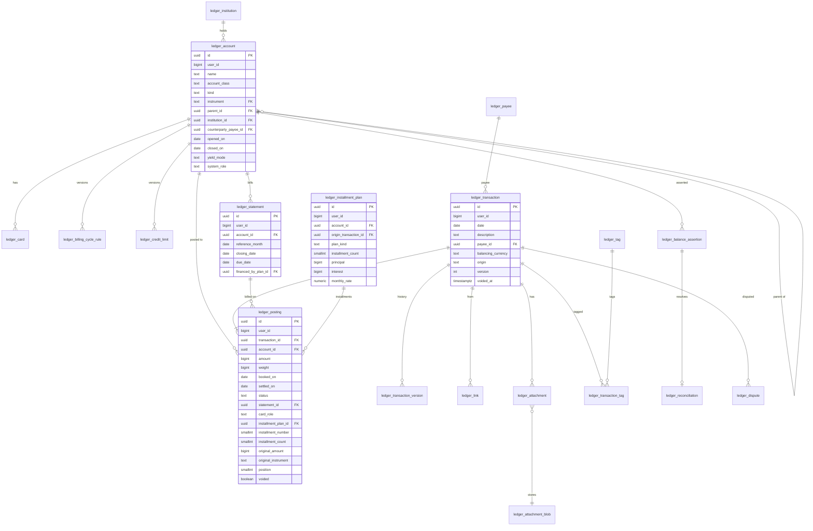
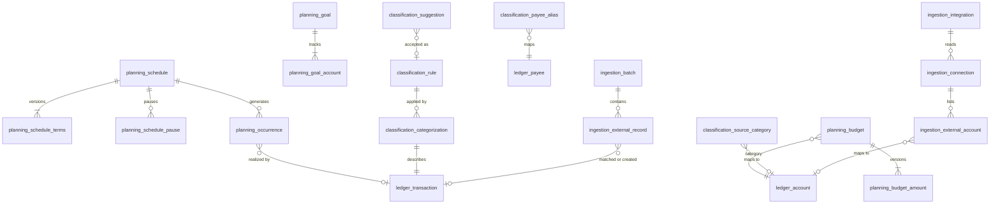

# 7. Data model

Status: approved

This chapter maps the domain model (chapter 5) to PostgreSQL 18 tables. It is the source for the migrations of every module.

## 7.1 Conventions

| Topic | Rule |
|---|---|
| Storage style | Current state in tables, history in version tables, cross-module events in the outbox (ADR 006). Not event sourcing: tables are the source of truth. |
| Identifiers | `uuid` generated by `uuidv7()` for every business table: time-ordered, stable across export and import. Identity keeps `bigint` user ids (ADR 003). |
| User isolation | Every business table has `user_id bigint NOT NULL`. References between business rows use composite foreign keys `(user_id, x_id) → (user_id, id)`, so a row can never reference another user's data, even through a bug. |
| Enumerations | `text` with a `CHECK (col IN (...))`. Adding a value is one migration; no `ALTER TYPE`. |
| Amounts | `bigint` in units scaled by the instrument scale (ADR 005, `Quantity`). Rates and prices: `numeric(30,12)`. Never floating point. |
| Dates | Accounting dates `date`; instants `timestamptz` (ADR 005). |
| Effective-dated values | One row per version with `effective_from`; `UNIQUE (subject_id, effective_from)`. The version in force at a date is the latest `effective_from ≤ date`, so versions cannot overlap (I08). |
| Audit columns | `created_at`, `updated_at` on every mutable table. |
| Table prefix | Owning module (chapter 4, 4.5). |
| Cross-module references | Foreign keys from a module to `identity_user`, `ledger_*` and `marketdata_*` tables are allowed: integrity takes precedence over decoupling inside one database. Writes stay with the owner (ADR 002). |
| Invariants | Enforced in the domain code first; the database repeats the ones that protect money (7.6) as constraints and deferred constraint triggers. |

## 7.2 Ledger

| Table | Columns not shown above | Constraints |
|---|---|---|
| `ledger_institution` | `id`, `user_id`, `name`, `code` (bank code, optional) | `UNIQUE (user_id, lower(name))` |
| `ledger_account` | `created_at`, `updated_at` | `CHECK` on class/kind pairs (chapter 5, 5.2.2); `UNIQUE (user_id, system_role) WHERE system_role IS NOT NULL`; `CHECK (closed_on IS NULL OR closed_on >= opened_on)` |
| `ledger_card` | `id`, `user_id`, `account_id`, `holder`, `last_four`, `virtual`, `active` | Account kind `credit_card` (trigger) |
| `ledger_billing_cycle_rule` | `account_id`, `effective_from` (first day of a reference month), `closing_day`, `due_day`, `closing_day_assignment`, `due_date_adjustment`, `calendar` | `UNIQUE (account_id, effective_from)`; days 1–31 |
| `ledger_credit_limit` | `account_id`, `effective_from`, `amount` | `UNIQUE (account_id, effective_from)` |
| `ledger_payee` | `id`, `user_id`, `name` | `UNIQUE (user_id, lower(name))` |
| `ledger_tag`, `ledger_transaction_tag` | `id`, `user_id`, `name`; `transaction_id`, `tag_id` | `UNIQUE (user_id, lower(name))` |
| `ledger_transaction` | `void_reason`, `external_record_id`, `created_at`, `updated_at` | `version >= 1`; `UNIQUE (user_id, external_record_id)` (P4 amendment A11) |
| `ledger_transaction_version` | `transaction_id`, `version`, `snapshot jsonb` (transaction and postings as they were), `reason`, `replaced_at` | `PRIMARY KEY (transaction_id, version)`; insert-only |
| `ledger_posting` | `memo` | `booked_on` equals the transaction date and `voided` equals the transaction's void state, both copied by triggers so balance sums read one partial index (N06); `card_role` and `statement_id` both set or both null; installment columns all set or all null; `installment_number BETWEEN 1 AND installment_count` |
| `ledger_link` | `id`, `user_id`, `from_transaction_id`, `to_transaction_id`, `link_type` | `UNIQUE (from_transaction_id, to_transaction_id, link_type)`; no self-link |
| `ledger_statement` | | `UNIQUE (account_id, reference_month)`; `due_date > closing_date` |
| `ledger_installment_plan` | `first_statement_id`; the status is derived, not stored | `installment_count BETWEEN 2 AND 420` |
| `ledger_balance_assertion` | `id`, `user_id`, `account_id`, `date`, `amount`, `source`, `recorded_at` | Insert-only |
| `ledger_reconciliation` | `id`, `user_id`, `account_id`, `date`, `assertion_id`, `difference`, `resolution`, `resolution_transaction_id`, `reconciled_at` | `UNIQUE (assertion_id)` |
| `ledger_dispute` | `id`, `user_id`, `transaction_id`, `opened_on`, `resolved_on`, `outcome`, `refund_transaction_id` | |
| `ledger_attachment` | `id`, `user_id`, `transaction_id`, `blob_sha256`, `file_name`, `media_type` | |
| `ledger_attachment_blob` | `user_id`, `sha256`, `size`, `content bytea` | `PRIMARY KEY (user_id, sha256)`; `size <= 10485760` (D2) |

## 7.3 Planning, Classification and Ingestion

| Table | Columns | Constraints |
|---|---|---|
| `planning_schedule` | `id`, `user_id`, `kind`, `account_id`, `counterpart_id`, `payee_id`, `description`, `currency`, `match_tolerance_bp`, `grace_days`, `ends_on`, `generated_until`, `created_at`, `updated_at` | Template accounts and payee by composite foreign keys (P7 amendment A46); `account_id <> counterpart_id`; tolerance 0–10000, grace 0–31 |
| `planning_schedule_terms` | `user_id`, `schedule_id`, `effective_from`, `frequency`, `interval`, `day_of_month`, `weekday`, `ordinal`, `business_day_ordinal`, `adjustment`, `calendar`, `start`, `until`, `count`, `amount`, `first_sequence` | `PRIMARY KEY (schedule_id, effective_from)` (I08); `first_sequence` set when kept occurrences hold the sequences the version would continue with; exactly one monthly selector, none otherwise; `weekday` and `ordinal` together |
| `planning_schedule_pause` | `user_id`, `schedule_id`, `period daterange` | `EXCLUDE USING gist (schedule_id WITH =, period WITH &&)`, extension `btree_gist` |
| `planning_occurrence` | `id`, `user_id`, `schedule_id`, `sequence`, `expected_on`, `expected_amount`, `state`, `transaction_id`, `realized_by`, `moved_from`, `skip_reason`, `declined_transaction_id` | `UNIQUE (schedule_id, sequence)`; `UNIQUE (user_id, transaction_id) WHERE transaction_id IS NOT NULL` (I07); state `expected`, `realized` or `skipped`, overdue derived (A50); `transaction_id` and `realized_by` set exactly when realized |
| `planning_budget`, `planning_budget_amount` | `id`, `user_id`, `category_account_id`, `period_type`, `rollover`, `currency`; `budget_id`, `effective_from`, `amount` | `UNIQUE (user_id, category_account_id)`; category class `expense` or `income`, checked by the domain; amounts from the first day of a month, `PRIMARY KEY (budget_id, effective_from)` (A54) |
| `planning_goal`, `planning_goal_account` | `id`, `user_id`, `name`, `target`, `currency`, `due_on`, `created_at`; `user_id`, `goal_id`, `account_id` | `UNIQUE (user_id, name)`; `target > 0`; accounts by composite foreign key (A55) |
| `classification_rule` | `id`, `user_id`, `name`, `priority`, `enabled`, `stop_processing`, `conditions jsonb`, `actions jsonb`, `schema_version` | `UNIQUE (user_id, priority)`, deferrable for reordering |
| `classification_payee_alias` | `id`, `user_id`, `pattern`, `match_type`, `payee_id` | `UNIQUE (user_id, match_type, pattern)` |
| `classification_suggestion` | `id`, `user_id`, `fingerprint`, `conditions jsonb`, `actions jsonb`, `example_transaction_ids uuid[]`, `state`, `rule_id`, `created_at`, `decided_at` | `UNIQUE (user_id, fingerprint)` (P5 amendment A24); `rule_id` only when `accepted` |
| `classification_source_category` | `id`, `user_id`, `provider`, `external_id`, `name`, `seen_count`, `category_id` | `UNIQUE (user_id, provider, external_id)`; `category_id` is an account of the same user (P6 A41) |
| `classification_categorization` | `transaction_id`, `user_id`, `transaction_version`, `transaction_date`, `method`, `rule_id`, `corrected`, `match_key`, `category_id`, `voided`, `decided_at` | `PRIMARY KEY (transaction_id)` (SC5); `method` NULL while uncategorized; a row changes only for a higher `transaction_version` (P5 amendment A20) |
| `ingestion_integration` | `id`, `user_id`, `provider`, `name`, `credential_ciphertext bytea`, `updated_at` | `UNIQUE (user_id, name)`; ciphertext sealed per ADR 008 with table, user and id as associated data (P6 A33, A34) |
| `ingestion_connection` | `id`, `user_id`, `integration_id`, `external_item_id`, `name`, `provider_status`, `last_item_update_at`, `last_synced_at`, `last_error`, `created_at` | `UNIQUE (user_id, integration_id, external_item_id)`; the integration is `ON DELETE RESTRICT` |
| `ingestion_external_account` | `id`, `user_id`, `connection_id`, `external_account_id`, `type`, `subtype`, `name`, `number_last4`, `currency`, `account_id`, `sync_from`, `ignored`, `last_synced_on`, `balance_on`, `balance_amount` | `UNIQUE (connection_id, external_account_id)`; `UNIQUE (user_id, account_id)` (one feed per ledger account); a mapped account has `sync_from`; an ignored one has no account (A35) |
| `ingestion_installment_plan` | `user_id`, `account_id`, `plan_key`, `plan_id` | Primary key `(user_id, plan_key)`; `plan_id` references `ledger_installment_plan` (A40) |
| `ingestion_csv_profile` | `account_id`, `user_id`, `delimiter`, `header_rows`, `date_column`, `date_layout`, `amount_column`, `debit_column`, `credit_column`, `decimal_separator`, `description_column`, `id_column`, `amount_sign` | One amount layout: `amount_column` or (`debit_column`, `credit_column`) |
| `ingestion_batch` | `id`, `user_id`, `source`, `external_account_id`, `account_id`, `file_name`, `currency`, `period_from`, `period_to`, `received`, `ignored`, `matched`, `created`, `needs_review`, `discarded`, `updated`, `withdrawn`, `balance_date`, `balance_amount`, `balance_status`, `balance_reason`, `started_at`, `completed_at` | Source `ofx`, `csv` or `open_finance`; a file batch has a file name and no external account, a sync the reverse (A36) |
| `ingestion_external_record` | `id`, `user_id`, `batch_id`, `account_id`, `external_id`, `dedup_key`, `raw jsonb`, `booked_on`, `amount`, `description`, `state`, `transaction_id`, `candidates uuid[]` | `UNIQUE (user_id, dedup_key)` (I10); `UNIQUE (user_id, transaction_id, account_id) WHERE transaction_id IS NOT NULL` (I07, P5b amendment A27); `transaction_id` follows `ledger.transactions_paired.v1` (A32); `transaction_id` set exactly in states `matched` and `created`. Duplicates are counted on their batch, never stored. Aggregator columns: `external_status`, `due_date`, `installment_number`, `installment_count`, `category_id`, `balance_after`, `unapplied_change`; state `withdrawn` (A36, A38); installment lines are exempt from the I07 index, one record per posting still holds. |

## 7.4 Market data, Portfolio, Reporting and infrastructure

| Table | Columns | Constraints |
|---|---|---|
| `marketdata_instrument` | `code` PK, `instrument_type` (the tax class of 5.6), `scale`, `name`, `quote_currency`, `exchange` | Instance-wide reference data; `scale BETWEEN 0 AND 12`; `quote_currency` set for securities only; `exchange IN ('B3')` |
| `marketdata_price` | `instrument`, `quote_instrument`, `date`, `value numeric(30,12)`, `source`, `priority`, `recorded_at` | `PRIMARY KEY (instrument, quote_instrument, date, source)`; `value > 0`; priority fixed by source (P8 amendment A60) |
| `marketdata_holiday` | `calendar`, `date`, `name` | `PRIMARY KEY (calendar, date)` |
| `ledger_trade` | `transaction_id` PK, `user_id`, `account_id`, `cash_account_id`, `side`, `quantity`, `unit_price numeric(30,12)`, `gross`, `fees`, `taxes`, `cost`, `currency` | D1 detail of a trade (A68); `cost` set for sales only; `taxes` 0 on purchases |
| `ledger_investment_income` | `transaction_id` PK, `user_id`, `account_id`, `cash_account_id`, `income_type`, `gross`, `withheld`, `currency` | D1 detail of an income (A70); `withheld < gross` |
| `portfolio_position_day` | `user_id`, `account_id`, `instrument`, `date`, `quantity`, `cost_basis` | Derived; one row per security account and date with postings; rebuilt per brokerage (A71) |
| `portfolio_realized_result` | `user_id`, `transaction_id` PK, `account_id`, `instrument`, `date`, `month`, `quantity`, `cost`, `proceeds`, `result`, `tax_class`, `currency` | Derived; `result = proceeds − cost` |
| `portfolio_income_event` | `user_id`, `transaction_id` PK, `account_id`, `instrument`, `date`, `income_type`, `tax_treatment`, `gross`, `withheld`, `currency` | Derived; `tax_treatment IN ('exempt', 'exclusive')` |
| `reporting_account_day` | `user_id`, `account_id`, `date`, `delta_booked`, `delta_settled`, `balance_booked`, `balance_settled` | Derived daily balance series (B02, B08); rebuilt per account from the first changed date |
| `outbox_event` | ADR 006 | |
| `<module>_processed_event` | `event_id`, `processed_at` | `PRIMARY KEY (event_id)`; Portfolio keeps none, its rebuild is idempotent |

## 7.5 Indexes

| Index | Serves |
|---|---|
| `ledger_posting (account_id, booked_on) INCLUDE (amount) WHERE NOT voided` | Balance at a date, statement of account, by transaction date |
| `ledger_posting (account_id, coalesce(settled_on, booked_on)) INCLUDE (amount) WHERE NOT voided` | Balance in the institution's view, reconciliation |
| `ledger_posting (statement_id)` | Statement amount due and status |
| `ledger_posting (installment_plan_id, installment_number)` | Installment plan view, committed amount |
| `ledger_transaction (user_id, date DESC, id DESC)` | Cursor pagination of the transaction list (ADR 005) |
| `ledger_transaction (user_id, payee_id, date)` | Payee history, categorization by history |
| `ledger_link (to_transaction_id)` | Refunds and reimbursements of a transaction |
| `planning_occurrence (user_id, expected_on) WHERE state = 'expected'` | Projections and matching |
| `ingestion_external_record (account_id, booked_on, amount) WHERE state = 'needs_review'` | Review queue |
| `marketdata_price (instrument, quote_instrument, date DESC)` | Latest price at a date |
| `reporting_account_day (account_id, date)` | Balance series |

## 7.6 Invariant enforcement in the database

| Invariant | Mechanism |
|---|---|
| I01 Weights sum to zero | Deferred constraint trigger on `ledger_posting`, checked at commit per touched transaction, ignoring voided transactions. |
| I02 At least two postings | Same trigger. |
| I03, I04 Statement only on card postings | Trigger: `statement_id` set if and only if the account kind is `credit_card`, and the statement belongs to the same account. |
| I05 Immutable postings | Trigger rejects `UPDATE` and `DELETE` of a posting whose status is `reconciled`, except the void copy and a change of its external record link (P6 A38); an explicit unlock (P3) sets `equori.unlock_reconciled`. Corrections of such transactions go through new transactions. |
| I06 Refund ceiling | Domain check inside the database transaction that locks the origin plan row (`SELECT ... FOR UPDATE`). |
| I07 One match per occurrence and record | Partial unique indexes (7.3); `ledger_posting.external_record_id` unique per user: a record confirms one posting (P5b amendment A27). |
| I08 No overlapping versions | `UNIQUE (subject_id, effective_from)` and the "latest effective_from" rule; exclusion constraint for pause periods. |
| I09 Account open on the date | Trigger compares `booked_on` with `opened_on` and `closed_on`. |
| I10 Unique deduplication key | `UNIQUE (user_id, dedup_key)`. |
| Same-user references | Composite foreign keys `(user_id, id)`. |

## 7.7 Derived data and export

| Data | Rule |
|---|---|
| Balances | Computed from `ledger_posting`; `reporting_account_day` is a cache rebuilt by outbox handlers and by a full rebuild command. |
| Statement amounts and status | Computed from postings and dates on read. |
| Positions and tax data | `portfolio_*` tables rebuilt from postings. |
| Export (SC6) | One JSON Lines file per table of facts (accounts, transactions with postings, links, statements, plans, assertions, schedules, rules, external records, attachments metadata), plus attachment files and a manifest with schema version and checksums. Derived tables are not exported. |

## 7.8 Decisions in this chapter

| ID | Decision | Alternative not taken |
|---|---|---|
| DD1 | Current-state tables with version history and outbox events. | Event sourcing: replay cost and projection complexity without a requirement that needs it. |
| DD2 | UUIDv7 identifiers for business tables. | `bigint` identity: ids collide when exporting from one instance and importing into another. |
| DD3 | Composite `(user_id, id)` foreign keys. | Single-column foreign keys: cross-user references prevented only by code. |
| DD4 | Money-protecting invariants repeated in the database. | Domain-only enforcement: a bug or a manual SQL edit can unbalance the ledger. |
| DD5 | Card postings carry a role (`charge`, `credit`, `payment`); a statement payment is a `payment` posting billed on the statement it pays. | A `payment_of` link: a link connects two transactions, while a payment targets a statement. |
