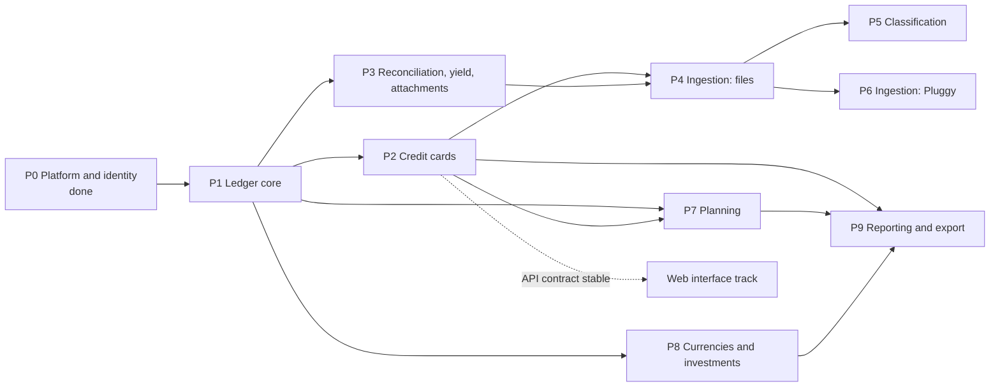

# 9. Roadmap

Status: approved

Implementation order, derived from the dependencies between contexts (chapter 4). Each phase gets its own implementation plan before any code is written; each plan is executed in slices of at most three tasks.

## 9.1 Dependency graph

## 9.2 Phases

| Phase | Scope | Scenarios | Exit criterion |
|---|---|---|---|
| P1 Ledger core | Market data minimum (currencies); institutions; accounts of every class with system roles and category tree; payees and tags; transactions and postings with I01, I02, I09; corrections, voids and version history; links; outbox (ADR 006); balances by booked and settled date; `reporting_account_day`; API for all of the above | S01–S04, S19, S20, S23 (checking part) | Scenarios pass; N02, N04 for I01, I02, I09 |
| P2 Credit cards | Business-day calendar with Brazilian national holidays (verified against an official source); card profile, billing cycle rules, credit limits; statements and billing service; card posting roles; purchases; installment plans; payments; charges; refunds; cancellation; anticipation; financing; revolving; disputes; cashback | S05–S15, S23 (card part) | Scenarios pass; I03–I06 enforced in database |
| P3 Reconciliation, yield, attachments | Balance assertions; reconciliation; yield mode; adjustments; tax on redemption; attachments | S24–S26, S31 | Scenarios pass |
| P4 Ingestion: files | Import batches; OFX and CSV parsers behind the anti-corruption layer; deduplication; matching; review queue; balance assertions from files | S32–S36 | SC2; N07 |
| P5 Classification | Rules, payee aliases, suggestions, categorization method statistics | — (classification scenarios added in its plan) | SC5 |
| P6 Ingestion: Pluggy | Credential encryption ADR; Meu Pluggy connection; account mapping; sync; statement hints and installments from the aggregator | — | Sync of a real account reconciles (SC1) |
| P7 Planning | Schedules, recurrence engine with business days, occurrences, subscriptions, budgets, goals, projections, committed amounts | S27–S29 | Scenarios pass |
| P8 Currencies and investments | Prices and feeds; multi-currency postings with weights; foreign purchases; exchanges; trades; investment income; Portfolio derived tables | S16, S17, S21, S22 | Scenarios pass; D1 data complete |
| P9 Reporting and export | Accrual and cash views; net worth; statement analytics; export and import round trip | S30 | SC6; N13 |
| Web interface | Separate track once the P2 API contract is stable: SPA embedded in the binary (ADR 002) | — | SC4, N21, N22 |

## 9.3 Next step

Write the implementation plan of P1 from chapters 5 to 7, then execute it slice by slice.
