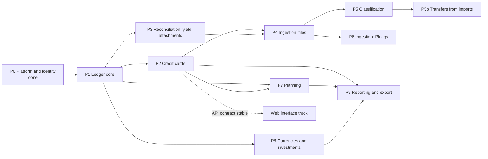
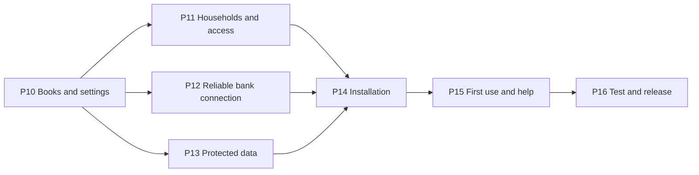

# 9. Roadmap

Status: approved

Implementation order, derived from the dependencies between contexts (chapter 4). Each phase gets its own implementation plan before any code is written; each plan is executed in slices of at most three tasks.

Current work: version 1.0, phases P10 to P16 (section 9.4). Sections 9.1 to 9.3 record phases P1 to P9, all delivered; plans and specs cite them by phase.

## 9.1 Delivered phases: dependency graph

## 9.2 Delivered phases P1 to P9

| Phase | Scope | Scenarios | Exit criterion |
|---|---|---|---|
| P1 Ledger core | Market data minimum (currencies); institutions; accounts of every class with system roles and category tree; payees and tags; transactions and postings with I01, I02, I09; corrections, voids and version history; links; outbox (ADR 006); balances by booked and settled date; `reporting_account_day`; API for all of the above | S01–S04, S19, S20, S23 (checking part) | Scenarios pass; N02, N04 for I01, I02, I09 |
| P2 Credit cards | Business-day calendar with Brazilian national holidays (verified against an official source); card profile, billing cycle rules, credit limits; statements and billing service; card posting roles; purchases; installment plans; payments; charges; refunds; cancellation; anticipation; financing; revolving; disputes; cashback | S05–S15, S23 (card part) | Scenarios pass; I03–I06 enforced in database |
| P3 Reconciliation, yield, attachments | Balance assertions; reconciliation; yield mode; adjustments; tax on redemption; attachments | S24–S26, S31 | Scenarios pass |
| P4 Ingestion: files | Import batches; OFX and CSV parsers behind the anti-corruption layer; deduplication; matching; review queue; balance assertions from files | S32–S36 | SC2; N07 |
| P5 Classification | Rules, payee aliases, payee history, suggestions, categorization method statistics, Ledger `Categorize` | S37–S44 | SC5; N07 with rules |
| P5b Transfers from imports | Rule actions "mark as transfer to account" and "mark reimbursable to counterparty"; pairing an imported card payment with the checking debit that paid it (P4 amendment A14); external record links per posting (I07) | S45–S50 | A card payment imported from both files counts once in every order; SC2 holds after pairing |
| P6 Ingestion: Pluggy | Credential encryption (ADR 008); integrations, several per user; Meu Pluggy connections; account mapping; scheduled and manual sync; updated and withdrawn lines; statement hints and installments from the aggregator; source categories; per-user isolation | S51–S59 | S51–S59 pass against a fake Pluggy; N15–N17 tests pass; sync of a real account reconciles (SC1, owner check per `docs/operations/pluggy.md`) |
| P7 Planning | Schedules, recurrence engine with business days, occurrences, subscriptions, budgets, goals, projections, committed amounts | S27–S29, S60–S63 | Scenarios pass; I07 (occurrence side) and I08 for schedule terms rejected by schema tests |
| P8 Currencies and investments | Securities as instruments; prices with the BCB PTAX and B3 COTAHIST feeds; conversion and valued balances; foreign purchases; exchanges; trades at average cost; investment income; Portfolio derived tables; planning in any currency (amendments A58–A72 of `docs/plans/2026-10-17-p8-currencies-investments.md`) | S16, S17, S21, S22, S64–S67 | Scenarios pass; D1 data complete |
| Regional neutrality | Region and language on the user; registries for calendars, price sources, identifier schemes, jurisdictions, aggregators, encodings and lexicons; locale conventions; regional settings screen (`docs/plans/2026-10-22-regional-neutrality.md`, ADR 016, `docs/contributing/regions.md`) | — | The checklist of `docs/contributing/regions.md` adds a region without editing a module core |
| P9 Reporting and export | Accrual and cash views; net worth; statement analytics; export and import round trip | S30 | SC6; N13 |
| Web interface | Separate track once the P2 API contract is stable: SPA embedded in the binary (ADR 028) | — | SC4, N21, N22 |

## 9.3 Delivery record of P1 to P9

P1 to P9 are delivered; the SC1 check of P6 waits for the owner (`docs/operations/pluggy.md`, section 5). P9 delivered the cash view of `getCategoryTotals` and the statement analytics (`docs/plans/2026-10-26-p9-cash-view.md`, S30, S145 to S148), and the export and import round trip (`docs/specs/2026-10-26-export-design.md`, SC6, N13). Left out of P9: the cash view of a financed statement and of revolving credit, which no scenario fixes, and the import of an archive of another schema version.

Amendment of 2026-10-26: the cash view of a financed statement and of revolving credit is delivered (CV7 to CV10 of `docs/plans/2026-10-26-p9-cash-view.md`, S149, S150). Reason: the owner decided the rule.

Amendment of 2026-10-26: the import of an archive of another schema version leaves the list above. ADR 021 versions the archive, and an archive of any earlier version imports into any later one.

## 9.4 Version 1.0

Status: approved by the owner on 2026-10-30. Input: the owner's competitive study of 2026-10-30, "O que os usuários reclamam nos apps de finanças" (https://claude.ai/artifact/YMqiwrXg5GJxoW8rVDSfpi#ab301e77-6893.m4ag25fxkb2.34601), and the owner's answers recorded in it. Next step: P10, starting with the design spec of shared books.

### 9.4.1 Scope decisions

| Topic | Decision |
|---|---|
| Audience | People with basic computer knowledge who follow a guide and paste one prepared terminal command. |
| Region | Complete use in Brazil. Other regions arrive after 1.0 as regional extensions (ADR 016). |
| Forms | Docker only: compose and the standalone image. Windows runs Docker Desktop with WSL2, with a guide and a one-command script. The Windows installer (ADR 023) and the Homebrew formula leave the supported set of 1.0. |
| Languages | Portuguese and English, both complete. |
| Households | Phases 0 to 3 of the shared-books plan: books, a member separate from the book, invitation, switch of the active book, roles `owner`, `write` and `read`. Phase 4 follows 1.0. |
| Aggregator | Meu Pluggy is the main path in Brazil; personal use is free without a time limit for up to 5 connections of one holder. File import (OFX, CSV) is the fallback. |
| Changed bank data | equori decides alone only when a rule leaves no doubt. Every automatic decision appears in the sync summary with an undo; every other case waits for review. |
| New versions | A new-version notice queries GitHub only with consent given at first access (amends N17). A backup runs before every upgrade in every form. |
| Errors | An on-demand diagnostic file without amounts, names or descriptions, attached by the owner to an issue. |
| Second factor | Optional TOTP and passkey with recovery codes, offered at first access and when remote access is set up. |
| Backup | Daily in every form; a copy encrypted with the owner's password to a chosen folder; the screen shows the date of the last backup and warns when the copy is late. |
| Settings | The environment holds only values needed before the database opens, security boundaries, and host or network values. Every other setting lives in the app at one level: instance, book, member or browser. The time zone moves to the book, with the region's zone as default; the sync interval moves to the instance screen; `EQUORI_GEMINI_API_KEY` is removed; appearance follows the member. |
| Support | GitHub Issues and Discussions, and the in-app help. |
| Notices | Inside equori only. |
| Testing | The owner and close people, with real accounts. |
| Release | By exit criteria, without a date. |

### 9.4.2 Phases

P11, P12 and P13 depend only on P10; the owner runs them one after the other, in table order. Each phase is specified, planned and executed under section 9.4.3.

| Phase | Status | Scope | Exit criterion |
|---|---|---|---|
| P10 Books and settings | delivered | ADR of shared books, replacing the user part of ADR 003; member, books and membership tables with a 1:1 backfill; session and access token per member and book; `user_id` renamed `books_id`, `auth.MustUserID` split into `MustBooksID` and `MustMemberID`; every setting classified by level; time zone per book; appearance per member; the Gemini key moved to the assistant settings | Every test passes after the rename; a schema test rejects a business row without a book; each setting has one level and one source |
| P11 Households and access | review | Invitation of a member, switch of the active book, roles enforced at one authorization point; optional TOTP and passkey with recovery codes | An HTTP test per role and per access without membership (404); login tests with TOTP, with a passkey and with a recovery code |
| P12 Reliable bank connection | review | The institution's transaction id (`providerId`) as record identity when present; a periodic re-read beyond the 30-day window; automatic decisions only on unambiguous rules, with undo; a summary per sync; a notice for a stalled connection and for an expiring consent; the assistant names stale and unreconciled accounts in its answers | Replays of the October 2026 incidents (repeated payment, late line, amount changed after reconciliation, pending line posted under a new id) end with no duplicate and no unreported change; a connection without update past the spec's limit shows on the overview |
| P13 Protected data | spec | Daily backup in every form; encrypted copy to a chosen folder; backup screen; backup before every migration; diagnostic file; consented new-version notice | An encrypted copy restored into an empty instance reproduces every fact and derived value; a test proves the diagnostic file holds no amount, name or description |
| P14 Installation | open | A configuration map in code that generates the installation guide and the example `.env`; start-up validation that names the variable, the expected value and an example; a one-command script (Docker check, WSL2 on Windows, free port, secret key, database password); first access by region and book; guides for Linux, macOS and Windows | A clean machine of each system reaches first access with one pasted command, checked in the release job or by a documented owner check |
| P15 First use and help | open | First-use walkthrough; help pages for installation, bank connection and troubleshooting in both languages; in-app notices for due statements and budgets | P16 testers record their first transactions without outside help |
| P16 Test and release | open | Security review; the owner and close people use real accounts of several banks; fixes; check of every exit criterion of P10 to P15; tag `v1.0.0` (ADR 022, V1) | Every exit criterion passes; no open defect of data loss, duplication or exposure |

### 9.4.3 Plans

The planning model writes the spec and the plan of each phase: Opus, effort high. The implementing model executes the plan: Sonnet, effort medium or high, as a subagent that the planning session dispatches and answers directly; the owner does not carry messages between them. The implementing model makes no design decision. Every choice that changes behavior, schema, contract or user-facing text is written in the plan. A case the plan does not cover stops execution.

Order of work for a phase:

1. Spec in `docs/specs/`, when the design is open. It records each decision and its reason. The plan cites the spec section and does not repeat the reason.
2. Plan in `docs/superpowers/plans/`, written after the planning model reads the code each task touches.
3. Plan check by the planning model in a new session, the session that then runs steps 4 and 5: every path, symbol and command named in the plan exists; every expected test value is derived; every Contract artifact passes the tool that reads it (a migration passes `make gen` and goose up and down); no question is open. Before execution, the check clears with the owner, in one question, every precondition a stop condition below would hit: files of another session in the working tree, an environment value, a pending owner decision.
4. Execution: the planning session dispatches one implementing subagent per task, in plan order, one at a time, with the task's effort. Each slice ends with its commits and its checkpoint, and the session continues with the next slice without waiting for the owner.
5. Review by the planning model at the end of the plan, in the same session: the diff against the plan's edge cases and the phase's exit criterion.

The Status column of section 9.4.2 names the step a phase is in: `open` before step 1, then `spec`, `plan`, `check`, `execution`, `review`, and `delivered` once the exit criterion passes. The model that starts a step updates the column in the commit of that step.

A plan holds at most four slices of at most three tasks. A larger phase is split into plans in dependency order.

| Plan section | Content |
|---|---|
| Goal | The exit criterion of section 9.4.2 that the plan serves, quoted. |
| Decisions | One row per decision: question, choice, source (spec section, ADR or owner). No open question remains. |
| Contract | The exact text of every artifact the implementing model would otherwise invent: migration SQL, sqlc queries, `api/openapi.yaml` fragments, signatures of exported Go functions and ports, `Problem.code` values, catalog keys with pt-BR and en text, each region-dependent value with its extension point. |
| Tasks | Grouped in slices. Each task names its effort, medium or high. High applies to migrations, money, authorization, session and bank-sync identity. |
| Edge cases | Each case with the task and the test that cover it. |
| Owner tasks | Steps the implementing model never executes: real bank accounts, a clean machine, a provider key, a release tag. |
| Out of scope | Adjacent changes that the implementing model leaves untouched. |

Each task holds:

- Files to create, modify and test, anchored by function or type name, never by line number.
- The failing test, written first, with its table of exact inputs and expected values, and the failure expected before the implementation.
- The implementation steps.
- The verification commands with their expected result. Commands are limited to the changed packages and never use the tags `eval` or `live`.
- The commit message.

A mechanical change across many files, such as the rename of `user_id` in P10, is a command or a script in the plan. The plan states the expected number of changed sites and the command that proves completion, with its expected output.

The implementing model stops, writes the checkpoint and reports when any condition holds:

- A file, symbol or command named in the plan is absent or has a different signature.
- The new test passes before the implementation.
- A test outside the task fails.
- The task needs a file, dependency, migration, operation, `Problem.code` or text that the plan does not list.
- The plan contradicts itself, an ADR, a spec or `CONTRIBUTING.md`.
- A verification command fails after two fix attempts.

After a stop, the planning model amends the plan and resumes the same subagent with the amendment. The owner is asked only for a decision that the spec, an ADR or the owner's earlier answers do not settle.

A new session starts only after a spec or a plan is written, after a plan is reviewed, or when the context reaches the limits of the execution slice protocol.

A model that ends its turn by recommending a new session, for the next step of this section or for any other task, gives the owner the message to send in that session:

- The message stands alone: it names the step, the plan or spec file, the checkpoint `.claude/progress/current.md`, the model and effort of the step, and the expected result and stop.
- It sits at the end of the reply, in one fenced code block, preceded by a line that starts with the marker 🔴 and names the target session, for example `🔴 Prompt for the new session (plan check, Opus, effort high):`.
- The marker is the only emoji allowed in a reply or document of this project; it exists so the owner finds the message among the rest of the reply.
- A reply gives exactly one marked block. The owner runs one session at a time and clears it before sending the next message, so phases that could run side by side run one after the other, in the order of the table of section 9.4.2.
- A step that waits on the owner, such as the owner tasks of a reviewed plan, goes into the next message as its first item: the new session asks the owner for the result in its single question and records it before the step it names.

### 9.4.4 After 1.0

| Item | Target |
|---|---|
| Phase 4 of shared books: transfer between books, consolidated report, shared expense with another book as counterparty | 1.x |
| Import from other applications (Mobills, Organizze, YNAB, Actual) | 1.1 |
| IRPF report, PDF and receipt reading with a local model, NFC-e items, CDI benchmark | 1.x |
| Windows installer and Homebrew formula as supported forms | 1.x |
| Notices outside equori (e-mail, push) | 1.x |
| Regional extensions: aggregators outside Brazil, CAMT.053 and MT940 import, import profiles per bank, further languages | After the Brazilian goal |
