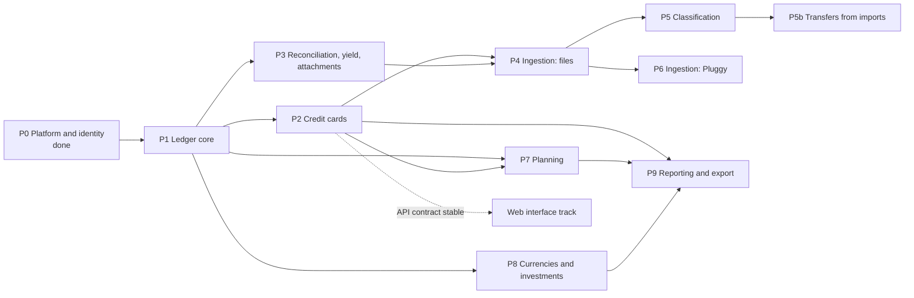

# 9. Roadmap

Status: approved

Implementation order, derived from the dependencies between contexts (chapter 4). Each phase gets its own implementation plan before any code is written; each plan is executed in slices of at most three tasks.

## 9.1 Dependency graph

## 9.2 Phases

| Phase | Scope | Scenarios | Exit criterion |
|---|---|---|---|
| P1 Ledger core | Market data minimum (currencies); institutions; accounts of every class with system roles and category tree; payees and tags; transactions and postings with I01, I02, I09; corrections, voids and version history; links; outbox (ADR 006); balances by booked and settled date; `reporting_account_day`; API for all of the above | S01–S04, S19, S20, S23 (checking part) | Scenarios pass; N02, N04 for I01, I02, I09 |
| P2 Credit cards | Business-day calendar with Brazilian national holidays (verified against an official source); card profile, billing cycle rules, credit limits; statements and billing service; card posting roles; purchases; installment plans; payments; charges; refunds; cancellation; anticipation; financing; revolving; disputes; cashback | S05–S15, S23 (card part) | Scenarios pass; I03–I06 enforced in database |
| P3 Reconciliation, yield, attachments | Balance assertions; reconciliation; yield mode; adjustments; tax on redemption; attachments | S24–S26, S31 | Scenarios pass |
| P4 Ingestion: files | Import batches; OFX and CSV parsers behind the anti-corruption layer; deduplication; matching; review queue; balance assertions from files | S32–S36 | SC2; N07 |
| P5 Classification | Rules, payee aliases, payee history, suggestions, categorization method statistics, Ledger `Categorize` | S37–S44 | SC5; N07 with rules |
| P5b Transfers from imports | Rule actions "mark as transfer to account" and "mark reimbursable to counterparty"; pairing an imported card payment with the checking debit that paid it (P4 amendment A14); external record links per posting (I07) | S45–S50 | A card payment imported from both files counts once in every order; SC2 holds after pairing |
| P6 Ingestion: Pluggy | Credential encryption (ADR 008); integrations, several per user; Meu Pluggy connections; account mapping; scheduled and manual sync; updated and withdrawn lines; statement hints and installments from the aggregator; source categories; per-user isolation | S51–S59 | S51–S59 pass against a fake Pluggy; N15–N17 tests pass; sync of a real account reconciles (SC1, owner check per `docs/operations/pluggy.md`) |
| P7 Planning | Schedules, recurrence engine with business days, occurrences, subscriptions, budgets, goals, projections, committed amounts | S27–S29, S60–S63 | Scenarios pass; I07 (occurrence side) and I08 for schedule terms rejected by schema tests |
| P8 Currencies and investments | Securities as instruments; prices with the BCB PTAX and B3 COTAHIST feeds; conversion and valued balances; foreign purchases; exchanges; trades at average cost; investment income; Portfolio derived tables; planning in any currency (amendments A58–A72 of `docs/superpowers/plans/2026-10-17-p8-currencies-investments.md`) | S16, S17, S21, S22, S64–S67 | Scenarios pass; D1 data complete |
| Regional neutrality | Region and language on the user; registries for calendars, price sources, identifier schemes, jurisdictions, aggregators, encodings and lexicons; locale conventions; regional settings screen (`docs/superpowers/plans/2026-10-22-regional-neutrality.md`, ADR 016, `docs/contributing/regions.md`) | — | The checklist of `docs/contributing/regions.md` adds a region without editing a module core |
| P9 Reporting and export | Accrual and cash views; net worth; statement analytics; export and import round trip | S30 | SC6; N13 |
| Web interface | Separate track once the P2 API contract is stable: SPA embedded in the binary (ADR 008) | — | SC4, N21, N22 |

## 9.3 Next step

P1 to P9 are delivered; the SC1 check of P6 waits for the owner (`docs/operations/pluggy.md`, section 5). P9 delivered the cash view of `getCategoryTotals` and the statement analytics (`docs/superpowers/plans/2026-10-26-p9-cash-view.md`, S30, S145 to S148), and the export and import round trip (`docs/superpowers/specs/2026-10-26-export-design.md`, SC6, N13). Left out of P9: the cash view of a financed statement and of revolving credit, which no scenario fixes, and the import of an archive of another schema version.
